<p align="center">
  
</p>

<h1 align="center">LUMEN 幕光</h1>

<p align="center"><strong>From a single sentence to a calm walk on stage.</strong></p>

<p align="center">An AI-native workbench for HTML decks · five steps to the stage · a real canvas · one file to ship</p>

<p align="center">
  <a href="README.md">中文</a> ·
  <a href="portal.html">Portal</a> ·
  <a href="plugins.html">Plugins</a> ·
  <a href="CHANGELOG.md">Changelog</a> ·
  <a href="LICENSE">License</a>
</p>

<p align="center">
  
  
  
  
</p>

<p align="center"></p>

<p align="center"><sub>No gaps between the five steps: prompt → outline → build → check → play. (Concept illustration; the real interface follows below.)</sub></p>

---

> **v0.4.0 "a workbench you can reshape"** — for the first time the workbench can be reshaped by plugins, or by a single sentence through the Creator. Plugins are local packages: offline, no marketplace. Creator changes are trialled first, kept only if you like them, and revertible at any time. With no plugin installed, the interface is identical to 0.3.0.

## What it is

**LUMEN** is an AI-native presentation workbench that lives in the browser. It does not put PowerPoint on the web — it asks a different question: **if a deck were born in the browser, from its very first sentence, what should it feel like?**

The answer is five steps, on one stage, from start to finish:

1. **Say it** — what you want to talk about, to whom, for how long;
2. **Shape it** — an outline of 3 to 20 slides, laid out and reorderable at any time;
3. **Build it** — real slides, one after another, 12 built-in layout recipes × 6 themes;
4. **Check it** — a pre-flight pass: overflow, contrast, type size, 3D budget, reading time;
5. **Play it** — full screen, or drop back onto the canvas and polish every last detail by hand.

Then export **one HTML file**. Copy it to a USB stick, open it on an offline meeting-room PC, and it plays on double-click.

| No backend | Zero telemetry | One HTML file | 5 steps |
| :---: | :---: | :---: | :---: |
| A static front end, no server | No tracking, no reporting | Double-click to play, portable | Prompt → outline → build → check → play |

## Why not just another deck tool

| Aspect | Traditional decks | **LUMEN** |
| --- | --- | --- |
| Deliverable | A binary file | A self-contained HTML: plays on double-click, searchable, indexable, hostable |
| Layout | Nudge every box by hand | Theme tokens + layout recipes: AI and humans both work inside the "good design space" |
| Content | Static text and images | Structured slides and blocks: searchable, diffable, portable |
| Interaction | Page turning only | Page turning + interactive HTML blocks + draggable 3D scenes |
| Iteration | Re-typeset everything | Change one place and the whole deck follows; editing and export share one renderer |
| Generation | None | Outline → slide-by-slide drafts → single-slide rewrites → natural-language refinement |

## Five steps to the stage

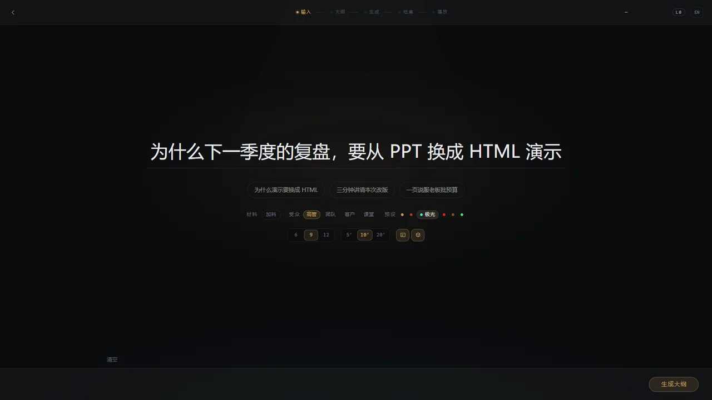

<p align="center"><sub>The Forge: five stages flow across one stage, so where you've been, where you are and where you're going are always visible.</sub></p>

All four entry points start the same flow: the top bar's "✦ Generate", the command palette (`⌘/Ctrl + K`), the empty-canvas button, or press-and-hold 400 ms on the "+" in the left rail. `Esc` exits at any time; an unfinished run writes nothing, finished slides land in the left rail immediately, and one undo takes you back to before the Forge.

| Stage | What you see | What you can do |
| --- | --- | --- |
| **1 · Prompt** | One sentence + three sample cards + slide count / length / visual toggles | The primary button stays disabled while empty; sample cards only fill in, never submit |
| **2 · Outline** | 3–20 slide cards, first and last locked | Swap one, delete a slide, add a slide, drag to reorder |
| **3 · Build** | Progress `3/9`, combo `×4` | Slide-by-slide drafting, cancel at any time; a cancel writes nothing |
| **4 · Check** | Blockers (error) and starred warnings (warn) | An error triggers one fallback re-layout; if it still fails, retry that slide alone; no play entry appears while stalled |
| **5 · Play** | `Play` / `Edit` | Full-screen premiere, `Esc` back to the canvas; "another one" starts over |

| Prompt | Outline |
| :---: | :---: |
| 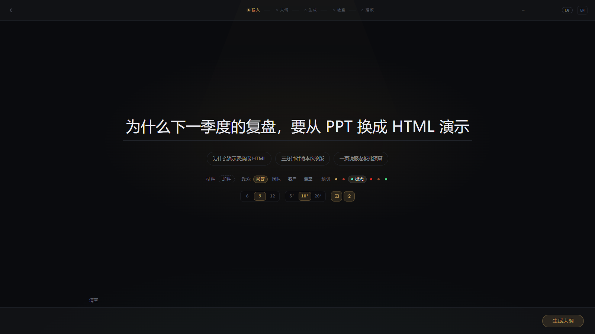 | 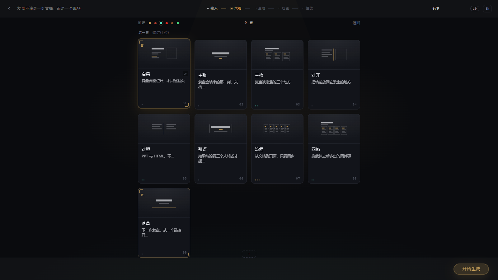 |
| <sub>One sentence + three samples; set slide count and length first</sub> | <sub>3–20 outline cards, reorder them with a drag</sub> |

| Build · assemble | Premiere · after the gate |
| :---: | :---: |
| 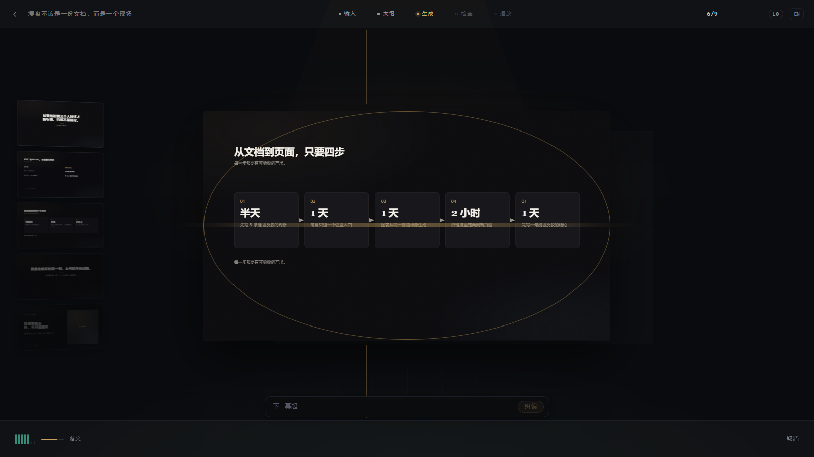 | 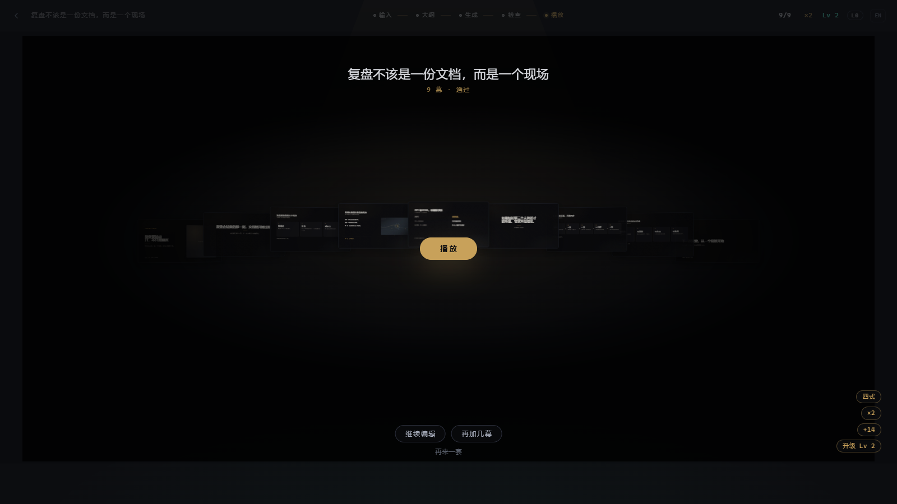 |
| <sub>Slide-by-slide drafting; progress and combo are real</sub> | <sub>All nine pass; one click to the stage, one click back to edit</sub> |

A few small things are hidden in the details:

- **Pacing**: generation is not "the faster the better". At least 640 ms between submit and outline, 560 ms between adjacent slides, 760 ms for a recast (the mock timeline); `?still=1` and `?channel=replay&speed=0` cut the wait to zero.
- **Fidelity tiers L0–L3**: decided once, only ever downgrades, and can be pinned in settings (L0 static / L1 light pipeline / L2 2.5D stage / L3 full motion). `?still=1` forces L0; older machines fall back automatically.
- **Game layer**: combo (capped at ×6), mastery (Lv 1–12), achievements — all computed locally, zero blocking, zero network, and nothing is gated behind it.
- **Keyboard**: `Tab` cycles, `Enter` submits, `←/→` picks a card, `Alt+↑/↓` reorders, `Del` deletes, `R` retries, `Esc` exits.

### Precision mode: edit the outline, let AI do the rest

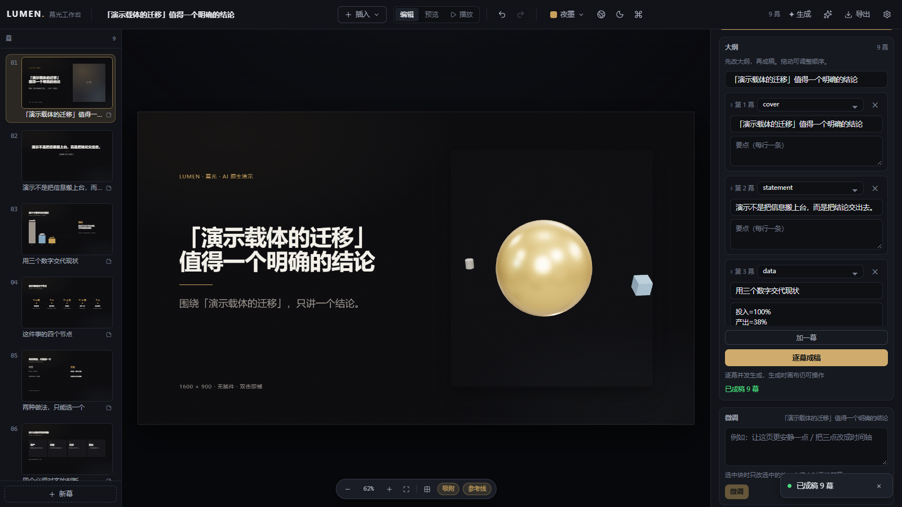

<p align="center"><sub>Outline and refinement stacked in the right rail: change the key points of slide 3, swap its layout, or select one slide and say "make this page quieter". AI only touches what you selected.</sub></p>

When you don't want to run the five steps again, precision mode puts AI back at the structural layer: tune the key points slide by slide, swap layouts, rewrite only the selected page — or edit the outline directly and let AI turn bullets into a timeline or compress a paragraph into one line.

## The canvas: AI builds the frame, you own the details

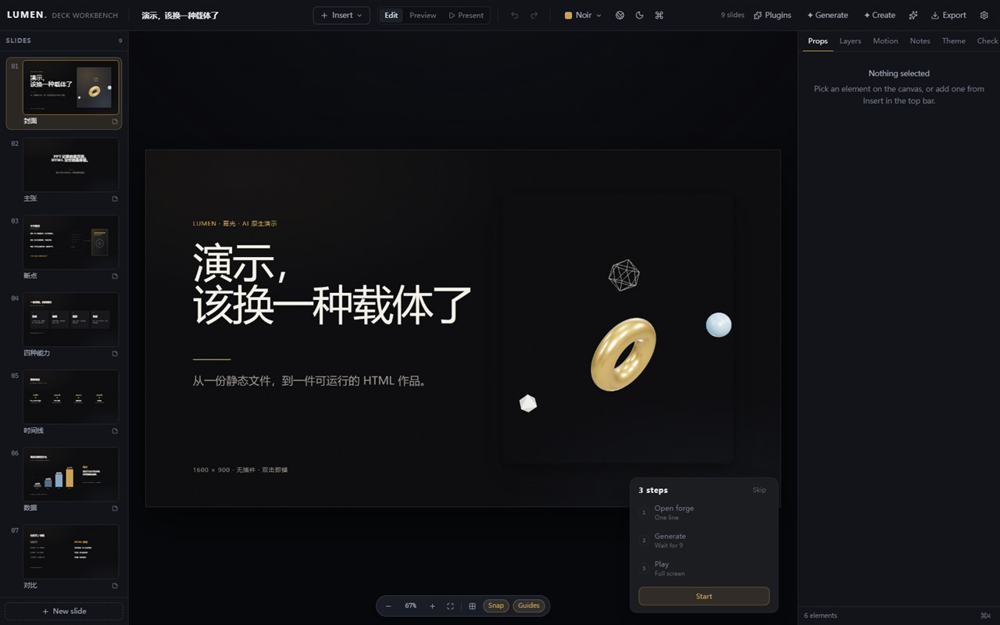

<p align="center"><sub>A 1600×900 canvas with zoom, snapping and guides ready; select an element to multi-select / marquee, 8-way resize, rotate, align and distribute, lock or hide it.</sub></p>

AI produces structure only — outline, slots, scene descriptors — and every block stays editable: draggable, rewritable, re-themeable. The canvas is not a preview; it is a real editor:

- **Six block types**: `text` `shape` `image` `svg` `three` `html` (sandboxed iframe), free to mix on one slide;
- **Hand editing**: inline text, exact values in the inspector, layer ordering, lock/hide, 200-step undo and redo;
- **Single-slide rewrite**: ask AI to rewrite, shorten or turn just one page into a timeline, or add one SVG illustration or one 3D view without rebuilding the whole deck.

## Expression: SVG and 3D are first-class

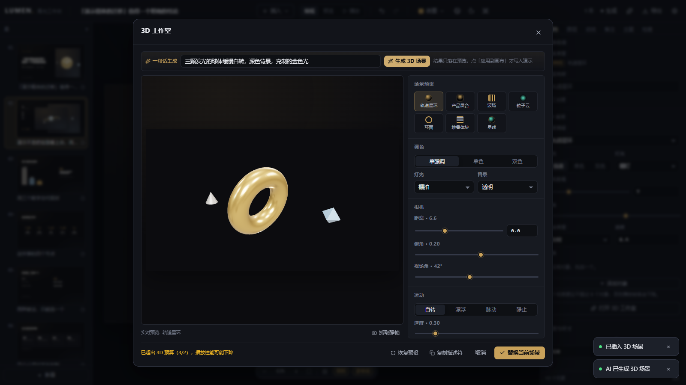

SVG and three.js are not "inserted assets" here; they are two native languages of a deck:

- **SVG**: the default form for illustration — re-colored by the theme, sanitized through an allow-list and mapped to color tokens, so it holds up under any theme; playback supports stroke growth, float and breathing motion.
- **3D**: not decoration — the memory hook. Restricted scene descriptors (preset + shapes + materials + lights + motion) deliver determinism, performance and exportability. 3D runs only on the current slide, stops off-screen, and thumbnails never create a WebGL context.

## Playback: transitions, presenter view and rehearsal

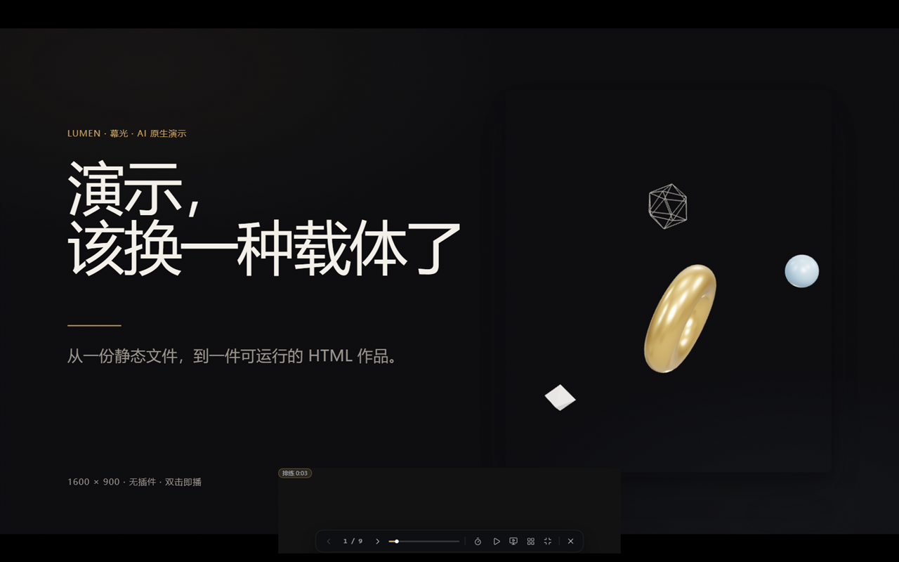

<p align="center"><sub>The v0.4.0 stage: full screen, rehearsal timer, autoplay, presenter view and overview — all in one control bar.</sub></p>

- **Transitions**: four animated transitions (fade / push / wipe / 3D flip) plus a hard cut — five options in total;
- **Presenter view**: notes + timer + next-slide preview, so you can keep the room and the clock in view;
- **Rehearsal timer**: know before you walk on whether you are running long;
- **Blackout and overview**: hush the room, or jump to any slide;
- **Autoplay**: kiosk loops or unattended playback;
- **Clicker**: hardware presenters work out of the box.

## Delivery: one HTML file

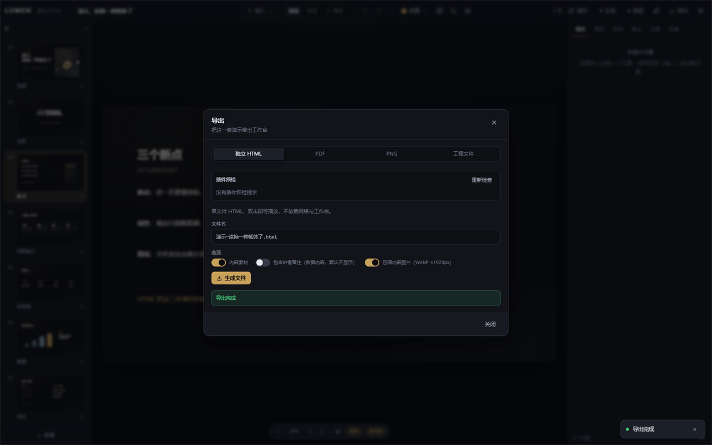

The exported standalone HTML comes from the same renderer as the editor: the player core and all assets are packed inside, so it plays from `file://` on double-click (e2e-asserted: zero external requests); `?print=1` turns it into a PDF through print. The same export pipeline also gives you:

| Format | What it is for |
| --- | --- |
| **Standalone HTML** | One file, offline, hostable; optionally inline assets and speaker notes, whole deck or current slide |
| **PDF** | In-app print route, rendered slide by slide; 3D slides capture a frame first |
| **Per-slide PNG** | 2× bitmaps by default; missing assets and failed pages are listed before export and can be retried alone |
| **`.lumen.json`** | Project file (assets included) to keep editing on another machine |

Size is handled too: large images are resampled to ≤1920 px WebP (quality 0.82) before inlining and replaced only when actually smaller; the preflight names the slides with missing assets.

## Channels: bring your own model, keep the offline path

- **Mock**: the default offline channel — deterministic samples, no key required, enough to walk the whole flow;
- **OpenAI-compatible**: streaming SSE, backoff retries, response cache; presets cover DeepSeek, OpenAI, local Ollama, self-hosted gateways and custom endpoints;
- **Replay**: a full deck recorded from a real model, played back offline; `?channel=replay&speed=0` means zero wait;
- Endpoints and keys live only in your browser and never travel with exported files.

## Reshaping #1: Plugins (new in v0.4.0)

Plugins are **local packages**, not cloud services. A `.lumenplug` is a UTF-8 JSON envelope (manifest + files + integrity): install from a file picker, by dragging it anywhere onto the window, or from a URL.

| Plugins page: three built-in samples | Plugin manager: every permission visible |
| :---: | :---: |
| 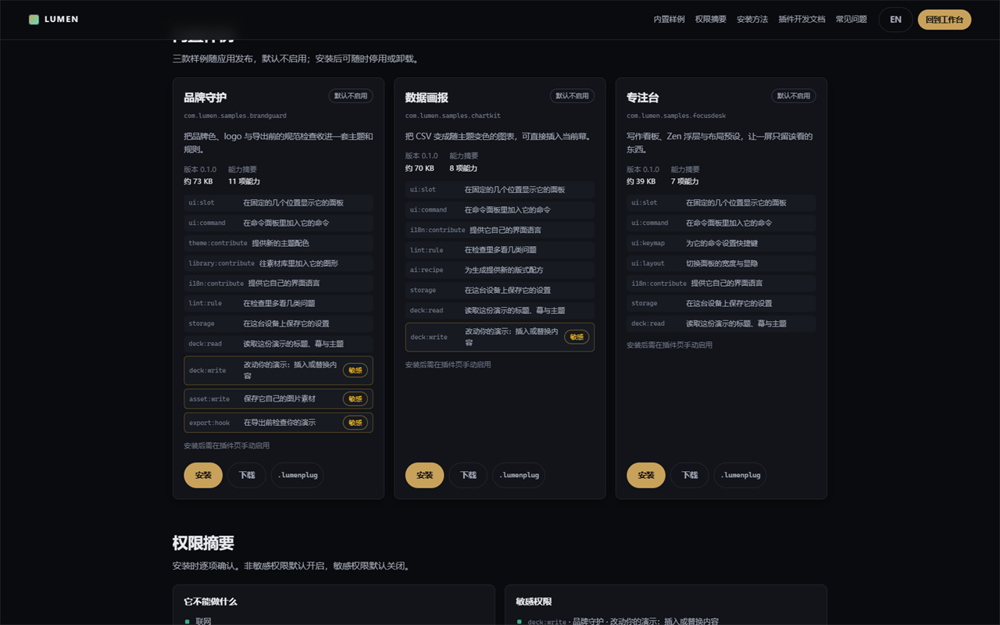 | 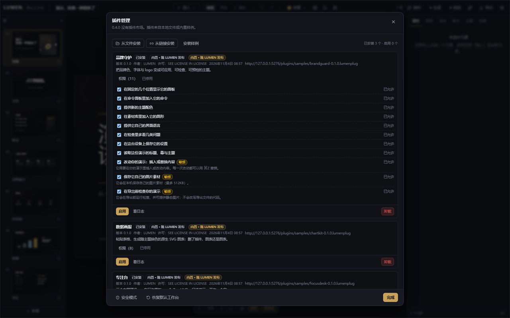 |
| <sub>Capabilities, size and sensitive permissions at a glance; install or download in one click</sub> | <sub>Installed list, each permission with its "sensitive" tag, enable / uninstall / view log</sub> |

- **Two forms**: declarative (pure JSON, rendered natively by the host, zero code execution) and code-based (manifest + a single ESM file, no build, no JSX, no external imports);
- **15 capabilities, 9 slots, 4 sensitive capabilities**: listed item by item at install time and toggled individually; `ai:invoke` / `deck:write` / `asset:write` / `export:hook` are off by default and need a second confirmation;
- **Security boundary**: code runs only inside an opaque-origin `<iframe sandbox="allow-scripts">` with no access to host DOM, cookies or IndexedDB; the iframe CSP is `connect-src 'none'` — **plugins cannot go online**, cannot read your files, cannot read other plugins' data;
- **Manageable**: the install confirmation states what it can and cannot do; a local audit log (200-entry ring), quarantine after 3 consecutive failed starts, safe mode via `?safe=1` / `#safe` or holding `Shift` at launch, and "reset workbench" behind a typed `RESET` (your deck is untouched).

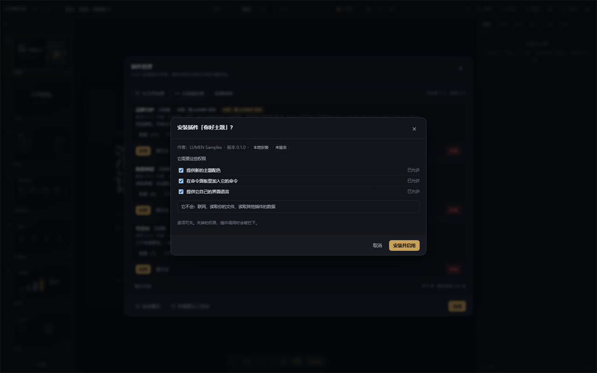

<p align="center"><sub>Unsigned or not, permissions are shown honestly: "It will not: go online, read your files, read other plugins' data."</sub></p>

The three built-in samples are off by default; install them in one click from [plugins.html](plugins.html), then enable them under "Plugins" in the top bar:

| Sample | What it does |
| --- | --- |
| **BrandGuard** | 3 brand themes, brand assets, 4 lint rules and a pre-export brand preflight |
| **ChartKit** | CSV / TSV / JSON → native SVG bar / line / donut / stacked charts that follow the theme; charts land as standard SVG blocks |
| **FocusDesk** | 3 layout presets, a writing board and a Zen HUD; it never requests `deck:write`, so it is truly read-only |

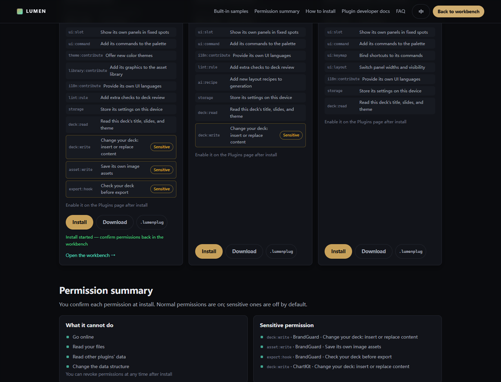

<p align="center"><sub>The same <code>plugins.html</code> in English: built-in samples, the permission summary, install steps, plugin developer docs and an FAQ.</sub></p>

## Reshaping #2: Creator (new in v0.4.0)

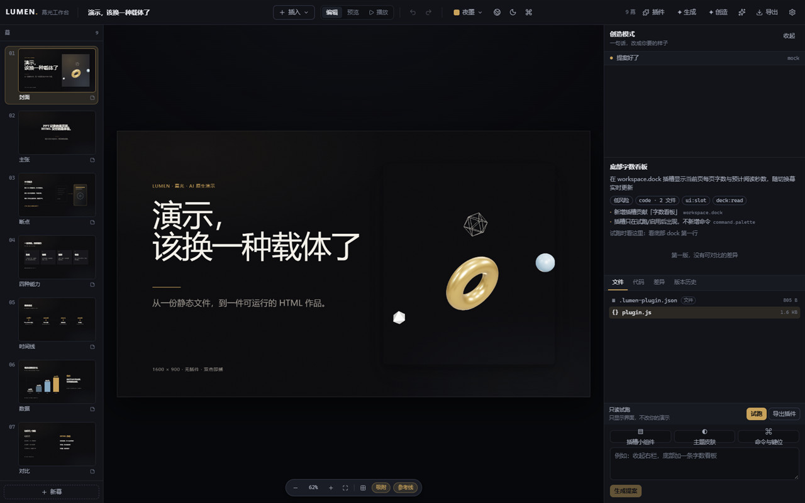

The Creator is a built-in host feature, not a plugin: **one sentence → proposal → sandboxed trial → keep / revert → export a plugin**.

1. **Say it**: name the place and the effect, e.g. "collapse the right panel and add a word-count board at the bottom".
2. **Read the proposal**: summary, risk level, changed points, file tree, read-only code, line diff and the last 10 revisions; a proposal that disagrees with its manifest or leaves the editable scope is rejected.
3. **Trial it**: the draft is hot-mounted in the current workbench and the canvas stays usable. The trial is read-only by default; only a proposal asking for `deck:write` shows an "Allow deck changes" switch, and turning it on needs a second confirmation. Trial edits go through transactions, and revert rolls back this trial's transaction.
4. **Keep / revert / export**: keep installs it as a local plugin under the same ABI and capability checks; export it as a `.lumenplug` using the same package format and sha256 calculation as installation.

No model needed: the start card has 3 templates (theme skin / slot widget / command & keys) that generate a proposal synchronously without calling a model. Four entry points: "✦ Create" in the top bar, the command palette (`⌘/Ctrl + K` → `creator.open`), `⌘/Ctrl + ⇧ + K`, and `?creator=1`. With a model, repairs run at most 2 rounds with trial errors fed back — but **no success rate is promised**, and failures come with a next step.

## The nine-scene sample

Nine cuts of one sample deck — the same story, told nine ways:

| Cover | Statement | Split |
| :---: | :---: | :---: |
| 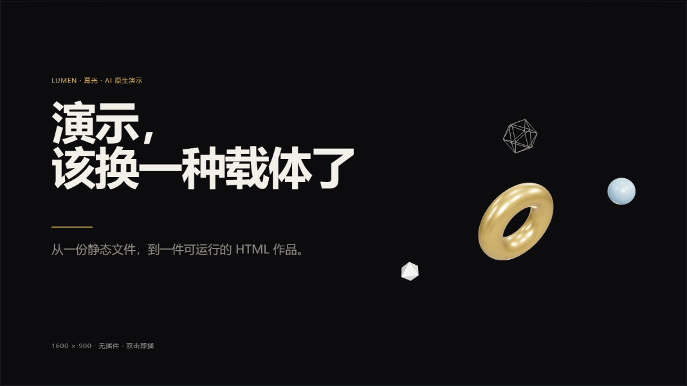 |  | 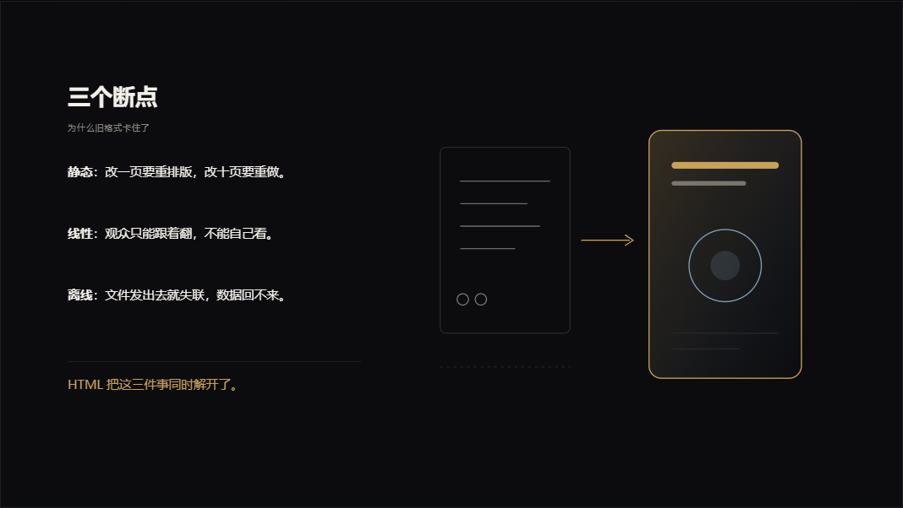 |

| Grid | Timeline | Data |
| :---: | :---: | :---: |
| 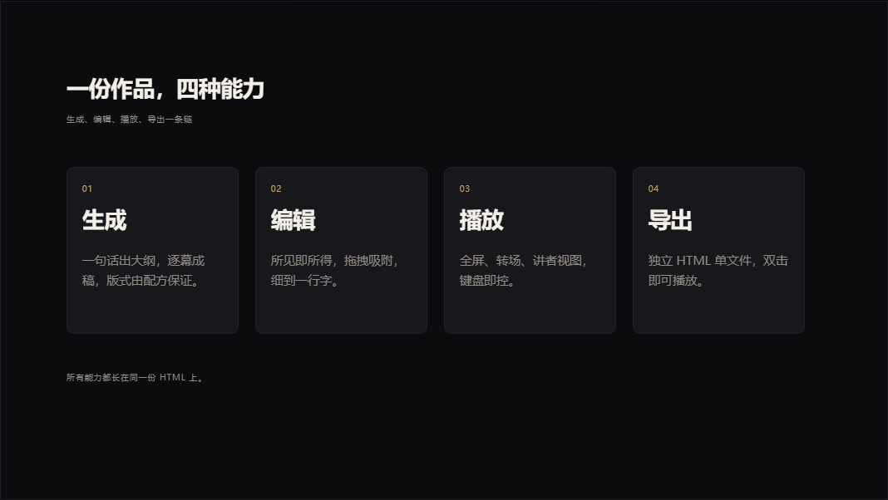 | 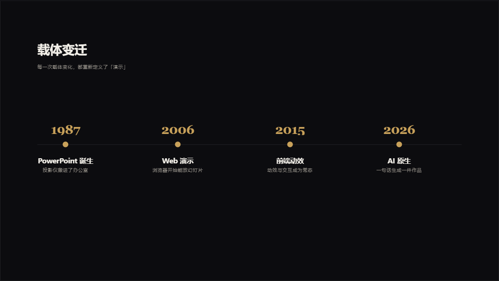 |  |

| Compare | Quote | Closing |
| :---: | :---: | :---: |
| 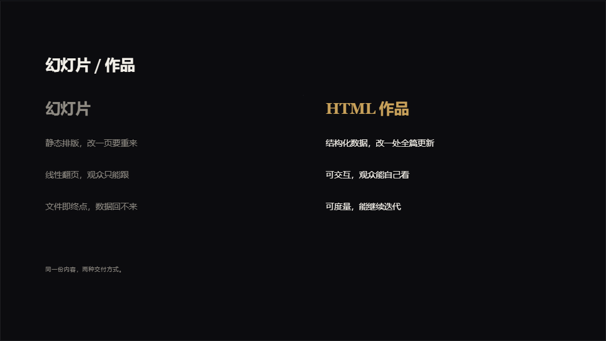 |  | 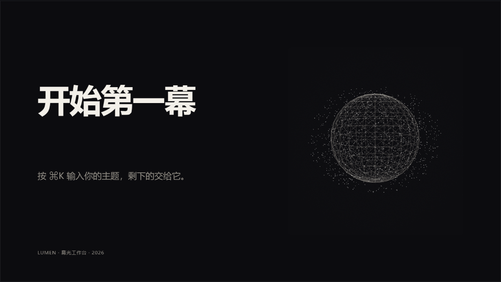 |

## Portal and first run

| Portal v0.4.0 | First run in three steps |
| :---: | :---: |
| 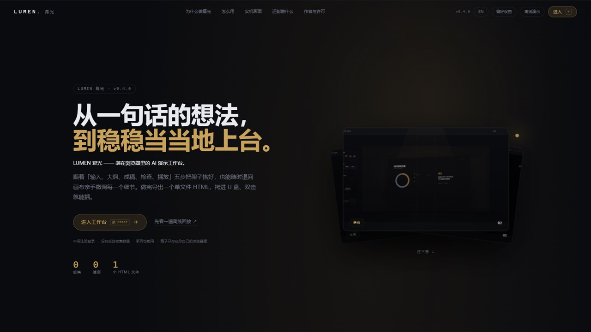 | 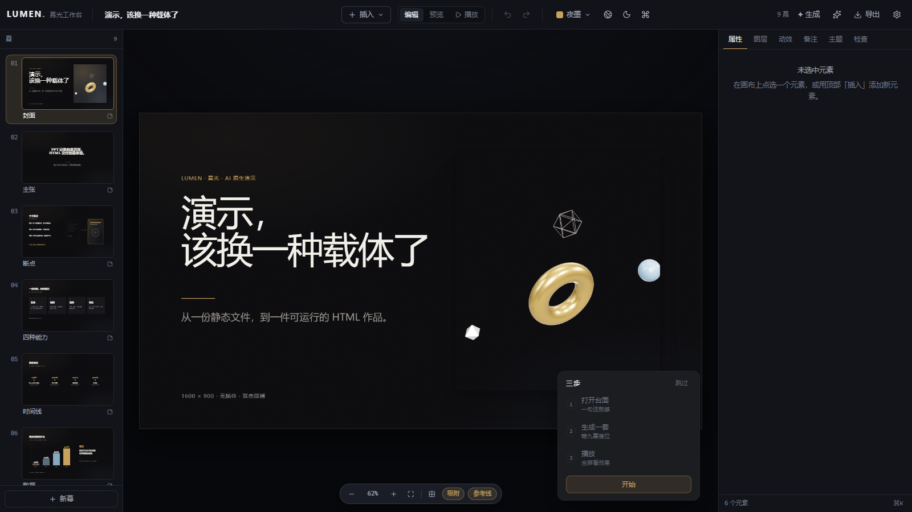 |
| <sub>A standalone entry `portal.html`: the pitch, the five steps, real screens, preferences, author and license</sub> | <sub>A three-step card in the bottom-right on first open: open the stage → generate a deck → play it</sub> |

<p align="center"><sub>Most screenshots show the Chinese UI; the editor and plugins page are also captured in English — the whole interface switches in one click.</sub></p>

<p align="center"><sub>Apart from the cover illustration, every screenshot is the real interface; editor, playback, composer and sample-slide shots can be re-taken with <code>pnpm snapshot</code> (output in <code>harness/out/</code>).</sub></p>

## Quick start

```powershell
pnpm install        # dependencies
pnpm dev            # builds the player core and sample plugins, then starts vite (port pinned to 5273)
# → http://127.0.0.1:5273
```

```powershell
pnpm test           # vitest (jsdom)
pnpm typecheck      # tsc --noEmit
pnpm lint:i18n      # zh/en key parity
pnpm e2e            # Playwright (boots a dev server on 5274)
pnpm build          # tsc + vite build → dist/
```

<details>
<summary><b>No pnpm? Direct commands / offline replay URLs / more scripts</b></summary>

```powershell
# Call the entries under node_modules directly (this is how the repo's own acceptance runs)
node node_modules/vitest/vitest.mjs run
node node_modules/typescript/bin/tsc --noEmit
node node_modules/@playwright/test/cli.js test

# Offline replay: zero external requests, a full deck start to finish
# http://127.0.0.1:5273/?channel=replay&speed=0
# http://127.0.0.1:5273/?still=1&channel=replay&speed=0   # plus L0 (screenshots / e2e)

pnpm test:security  # security red team (separate config)
pnpm pack:plugins   # repack the three .lumenplug files
pnpm snapshot       # screenshots into harness/out/
```

</details>

> Dev URL `http://127.0.0.1:5273`; portal `http://127.0.0.1:5273/portal.html`; plugins page `http://127.0.0.1:5273/plugins.html`.

## Privacy and local-first

- **The workbench itself is a static front end**: no backend, no telemetry, no remote fonts; it works offline (Mock / Replay are both offline paths).
- Data lives only in local IndexedDB (one database `lumen-deck`, DB v4, eight stores). Clearing site data clears everything.
- Model endpoints and keys are filled in by you and stored only in local settings; exported `.lumen.json` files and standalone HTML contain neither.
- Plugin data is local too: plugins cannot go online and their data never enters the deck; uninstalling removes plugin data by default (you can opt to keep it).
- The diagnostics JSON must be exported manually from settings and sent by you — **that is exactly the price of "no telemetry"**.
- The repo also carries an optional Edge CORS relay template (`api/llm-proxy.ts`), used only when browser-direct calls are blocked by CORS: it never enters the front-end build output, but a Vercel deploy publishes it as an Edge Function — delete the file if you do not want that.

## Stack and engineering

| Layer | Choice |
| --- | --- |
| View | React 19.2 · TypeScript 5.9 (strict) · Vite 7.3 |
| State | zustand 5 + immer 11 (patch history, 200 steps) |
| Contract | zod 3.25 (`src/schema/deck.ts` is the single data contract) |
| 3D | three r186 (lazy-loaded; thumbnails never create a WebGL context) |
| Other | DOMPurify 3 (SVG sanitizing) · CodeMirror 6 (SVG/HTML editing) · hand-rolled IndexedDB wrapper (`kv.ts`) |
| Tests | vitest 48 files / 1,028 cases + a 6-file / 38-case security red team; Playwright 16 specs / 49 cases (sampled 2026-11-04) |

- **CI**: three GitHub Actions jobs — verify (typecheck / test / build / sample-pack consistency / budget gate), e2e, and the security red team.
- **Guardrails**: first-screen size and lazy-load gate (`scripts/budget-check.mjs`, ≤45 KB gzip increase); the plugin runtime, manager and Creator must stay separate chunks.
- **Deploy**: static output, `pnpm build` → `dist/`, no SSR, no environment variables; installable, offline PWA.
- **End-to-end exercise**: `simulation/` ships a zero-dependency mock OpenAI-compatible endpoint plus a Playwright driver that runs the whole chain with a real browser, real SSE and real IndexedDB (`pnpm sim:llm`).
- **Bilingual**: instant zh/en switching with 1,627 keys × 2 languages and strict parity (`pnpm lint:i18n`).

## Project layout

<details>
<summary><b>Expand the directory tree</b></summary>

```text
src/
├─ schema/ state/ persistence/ themes/ styles/   # contracts, state, storage, themes, tokens
├─ render/                                       # the one renderer (stage/play/thumb/print/export)
├─ editor/                                       # canvas interactions, slide rail, inspector, toolbar, shortcuts
├─ ai/                                           # provider, channels (mock/openai/replay), prompts, recipes, outline/refine
├─ forge/                                        # the Forge: state machine, five stages, cards, HUD, tiers, game layer, pacing
├─ plugins/                                      # plugin runtime: package/manifest/capabilities, iframe host, RPC, declarative contributions, SDK
├─ creator/                                      # the Creator: state machine, proposal, diff, trial, templates, .lumenplug export
├─ pages/plugins/                                # plugins.html: three sample install cards and permission summary
├─ onboarding/ portal/                           # three-step first run / standalone portal (portal.html)
├─ fixtures/ai/                                  # replay offline fixtures
├─ studio/                                       # SVG / 3D studio and curated library
├─ play/ player/                                 # player and player-core entry (IIFE build)
├─ export/                                       # standalone HTML, print/PDF, PNG, project file
├─ ui/ i18n/ sample/ version.ts                  # primitives, copy, 9-slide sample, single source of truth for the version

plugins/builtin/                                  # repo root: three sample sources (packed into .lumenplug)
tests/unit/  tests/e2e/  tests/security/          # pure logic / Playwright / security red team
scripts/                                          # dev server, player build, screenshot harness, sample packing, budget gate
doc/screenshots/                                  # README screenshots and brand art (doc bodies stay local)
```

</details>

## Docs and deploy

- The design and contract docs (`00` engineering contract … `13` the Creator) and each release's `plan/` evidence pack **are kept in the local working copy only and are not published with the repository**; user-facing change summaries live in [CHANGELOG.md](CHANGELOG.md). Ask the author if you need the docs.
- Static output: `pnpm build` → `dist/` (three HTML entries: `index.html`, `portal.html`, `plugins.html`). The repo carries [`vercel.json`](vercel.json); importing it on Vercel is enough (framework detected as Vite, Node 22.x).

```powershell
pnpm run deploy:preview   # preview deploy → *.vercel.app
pnpm run deploy:prod      # production deploy
```

> The `run` matters: `pnpm deploy` is pnpm's built-in workspace deploy command and shadows the same-named script.

## License

The source is source-available under **Apache-2.0 + Commons Clause**, with **FSL-1.1-MIT** as an alternative track; design and sample assets remain **CC BY-NC 4.0**. Releases up to `v0.2.0` keep their historical `CC BY-NC 4.0` terms.

- **You may**: self-host, deploy internally, modify, build on it, embed it in a larger product, use it for teaching and research; Apache-2.0's patent grant still applies.
- **You must**: keep the copyright and license notices; ship [`LICENSE`](LICENSE) and [`NOTICE`](NOTICE) with redistributed derivatives.
- **You may not**: sell LUMEN itself (or a renamed equivalent), use the sample copy, screenshots or brand assets in commercial delivery, or use the LUMEN name/logo as your own brand.
- Need the certainty of "automatically MIT two years after each release"? Elect [`LICENSE-FSL-1.1-MIT.md`](LICENSE-FSL-1.1-MIT.md) instead — pick one track, not both.

Full texts and boundaries: [`LICENSE`](LICENSE) · [`LICENSE-FSL-1.1-MIT.md`](LICENSE-FSL-1.1-MIT.md) · [`LICENSE-CC-BY-NC-4.0.txt`](LICENSE-CC-BY-NC-4.0.txt) · [licensing guide](LICENSING.md) · [trademark note](TRADEMARK.md). Commercial licensing: [lzytttttt@gmail.com](mailto:lzytttttt@gmail.com).

> Because of the Commons Clause, this project is **source-available**, not OSI open source; please do not market it as "open source".

---

<p align="center">
  
  <br />
  <sub><b>LUMEN 幕光</b> · put an idea on stage with one sentence.</sub>
  <br />
  <sub>By <a href="https://github.com/lzytttttt">无极Ayaya</a> · <a href="https://github.com/lzytttttt/LUMEN">github.com/lzytttttt/LUMEN</a> · <a href="mailto:lzytttttt@gmail.com">lzytttttt@gmail.com</a></sub>
  <br />
  <sub>Contributing: <a href="CONTRIBUTING.md">CONTRIBUTING.md</a> · Security: report privately, see <a href="SECURITY.md">SECURITY.md</a></sub>
</p>
