<p align="center">
  
</p>

<h1 align="center">LUMEN 幕光</h1>

<p align="center"><strong>从一句话的想法，到稳稳当当地上台。</strong></p>

<p align="center">浏览器里的 AI 原生 HTML 演示工作台 · 五步成稿 · 画布可改 · 一个文件带走</p>

<p align="center">
  <a href="README.en.md">English</a> ·
  <a href="portal.html">门户</a> ·
  <a href="plugins.html">插件页</a> ·
  <a href="CHANGELOG.md">更新日志</a> ·
  <a href="LICENSE">许可</a>
</p>

<p align="center">
  
  
  
  
</p>

<p align="center"></p>

<p align="center"><sub>五步之间没有断点：一句话 → 大纲 → 成稿 → 检查 → 开演。（概念插画；真实界面见下文）</sub></p>

---

> **v0.4.0「可塑工作台」** —— 工作台第一次可以被插件改造，也可以用一句话把自己改成你要的样子。插件是本地包，离线、无市场；创造模式产出的改造先试跑、再保留，随时可撤销。不装任何插件时，界面与 0.3.0 完全一致。

## 这是什么

**LUMEN 幕光** 是一个装在浏览器里的 AI 原生 HTML 演示工作台。它不想把 PPT 搬上网页，而是重新回答一个问题：**如果一场演示从第一句话开始就长在浏览器里，它应该是什么样子？**

答案是五步，从头到尾在同一张台面上：

1. **说一句** —— 你想讲什么，给谁讲，讲多久；
2. **理大纲** —— 3 到 20 幕的结构先摊开，顺序随时可调；
3. **出画面** —— 一页页生成真稿，12 个内置版式配方 × 6 套主题；
4. **过一遍** —— 上台前自动体检：溢出、对比度、字号、3D 预算、阅读时长；
5. **开演** —— 全屏播放，或者退回大画布，把每个细节亲手抠一遍。

做完，导出**一个 HTML 文件**。拷进 U 盘，换一台没有网络的会议室电脑，双击就能播。

| 0 个后端 | 0 项遥测 | 1 个 HTML 文件 | 5 步上台 |
| :---: | :---: | :---: | :---: |
| 纯静态前端，没有服务器 | 不埋点、不上报 | 双击即播，拷走就走 | 输入 → 大纲 → 生成 → 检查 → 播放 |

## 为什么不只是又一个 PPT

| 维度 | 传统 PPT | **LUMEN 幕光** |
| --- | --- | --- |
| 交付物 | 一个二进制文件 | 一个自包含 HTML：双击即播、可搜索、可索引、可托管 |
| 版式 | 手工对齐每一个框 | 主题令牌 + 版式配方，AI 与人都只在「好设计的空间」里工作 |
| 内容 | 静态文本与图片 | 结构化的幕与块：可检索、可 diff、可迁移 |
| 交互 | 只会翻页 | 翻页 + 可交互 HTML 块 + 可拖动的 3D 场景 |
| 迭代 | 重新排版 | 改一处，全篇一致；编辑与导出共用同一套渲染器 |
| 生成 | 无 | 大纲 → 逐幕成稿 → 单页重写 → 自然语言微调 |

## 五步上台

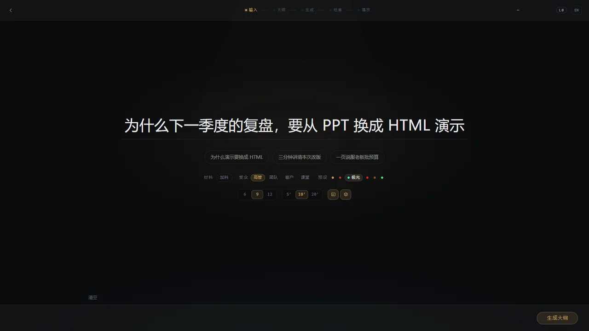

<p align="center"><sub>造幕台：五段在同一张台面上流转，已走过、正在走、还没到的位置一眼可见。</sub></p>

四个入口都触发同一条流程：顶栏「✦ 生成」、命令面板（`⌘/Ctrl + K`）、画布空态按钮，或长按左侧幕栏的「+」400ms。`Esc` 随时退出，中途取消不落库，做完的幕立刻进左侧幕栏，一次撤销回到造幕前。

| 步 | 你看到的 | 你能做的 |
| --- | --- | --- |
| **1 · 输入** | 一句话 + 三张示例卡 + 幕数 / 时长 / 画面开关 | 空输入时主按钮不可点；示例卡只填入、不提交 |
| **2 · 大纲** | 3–20 张幕卡，首末两幕锁定 | 换一张、删一幕、加一幕、拖动换序 |
| **3 · 生成** | 进度 `3/9`、连击 `×4` | 逐幕成稿，随时取消；取消不落库 |
| **4 · 检查** | 卡点（error）与星标（warn） | error 先自动兜底重排；仍不过就单独重试这一幕；卡住期间不出现播放入口 |
| **5 · 播放** | `播放` / `编辑` | 全屏开演，`Esc` 回画布；「再来一套」重开 |

| 输入 | 大纲 |
| :---: | :---: |
| 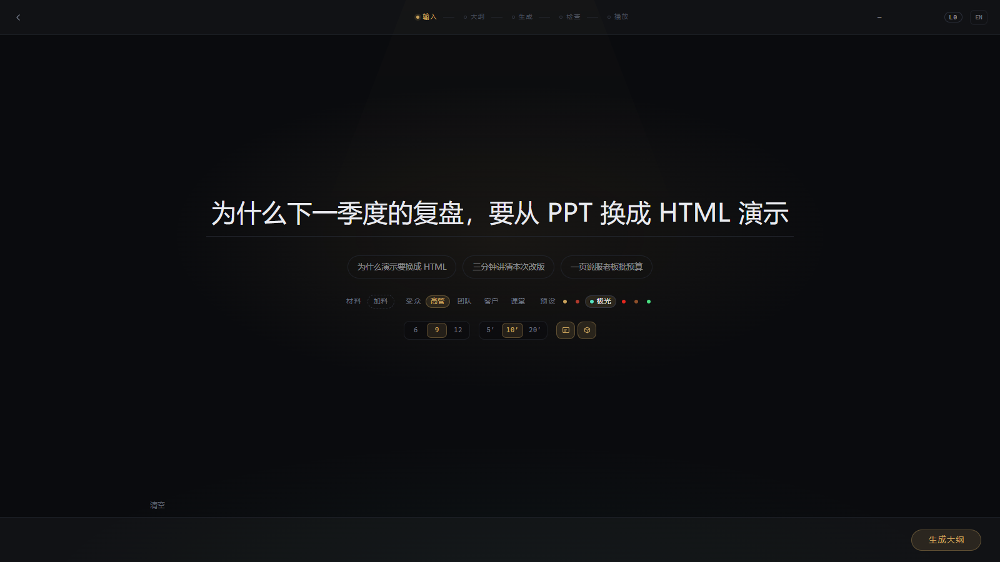 | 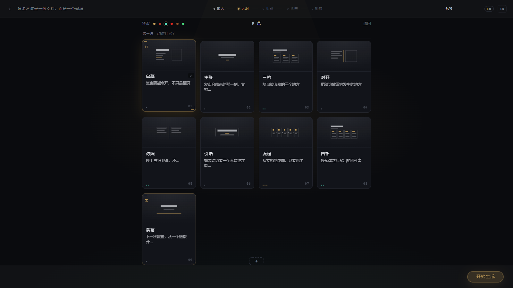 |
| <sub>一句话 + 三张示例卡，先定幕数与时长</sub> | <sub>3–20 幕大纲先摊开，鼠标拖一拖就能调顺序</sub> |

| 生成 · 装台 | 开演 · 过检之后 |
| :---: | :---: |
| 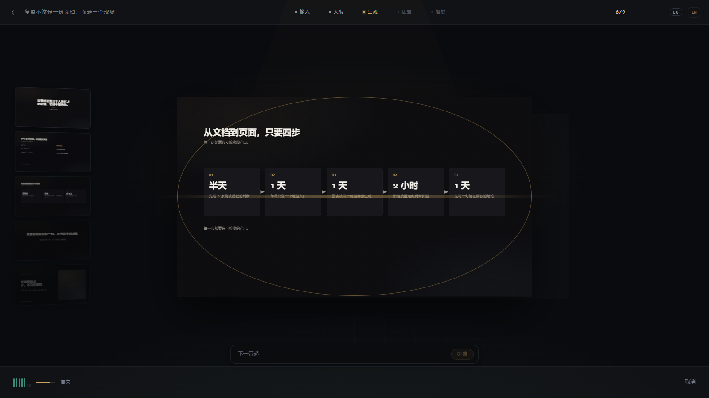 | 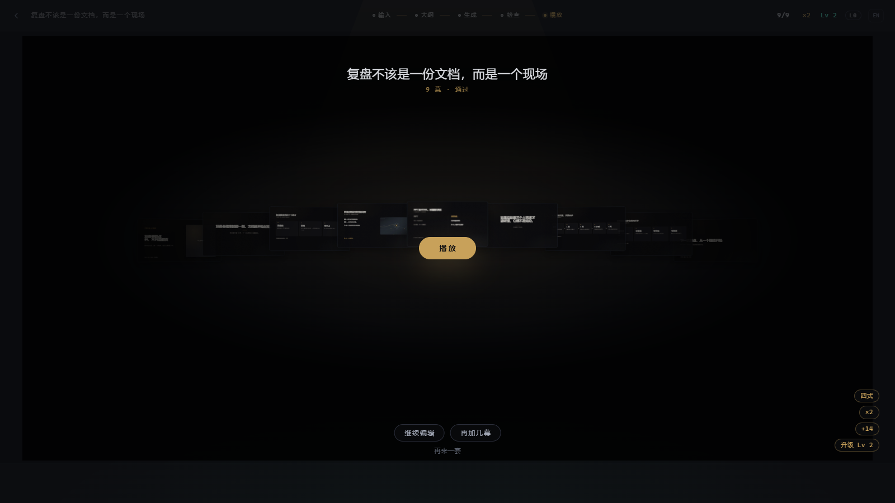 |
| <sub>逐幕成稿，进度与连击都是真值</sub> | <sub>九幕全部通过，一键上台；不满意随时回编辑</sub> |

细节里还藏着几件小事：

- **演出节奏**：生成不是「越快越好」。提交后至少 640ms 才出大纲，相邻两幕 560ms、重铸 760ms（mock 时间线）；`?still=1` 与 `?channel=replay&speed=0` 为 0 等待。
- **降级档 L0–L3**：一次判定、只降不升，可在设置里锁档（L0 静态 / L1 流水线 / L2 2.5D / L3 全动效）。`?still=1` 强制 L0，低端机自动退档。
- **游戏化**：连击（上限 ×6）、熟练度（Lv 1–12）、成就，全部本地计算，零阻塞、零网络、不解锁任何功能。
- **键盘**：`Tab` 循环、`Enter` 提交、`←/→` 选卡、`Alt+↑/↓` 换位、`Del` 删幕、`R` 重试、`Esc` 退出。

### 精确模式：对着大纲让 AI 改

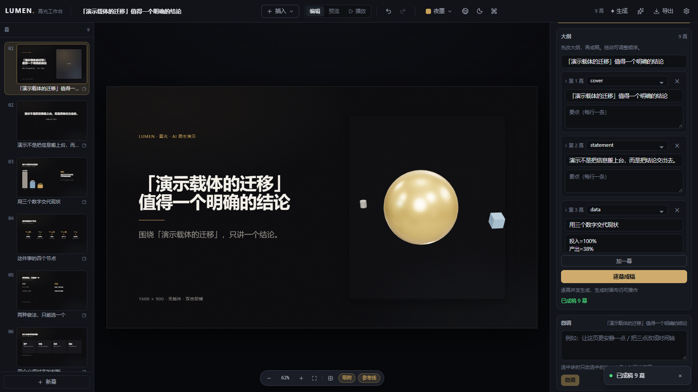

<p align="center"><sub>右栏的「大纲」与「微调」上下排列：改第 3 幕的要点、换版式，或者选一页说一句「让这页更安静一点」。AI 只改你选中的地方。</sub></p>

不想把五步从头再跑一遍时，精确模式让 AI 回到「结构」这一层：逐幕调要点、换版式、只重写选中的一页；也可以直接对着大纲改字，让 AI 把要点变成时间轴、把长段压成一句。

## 画布：AI 搭好架子，细节归你

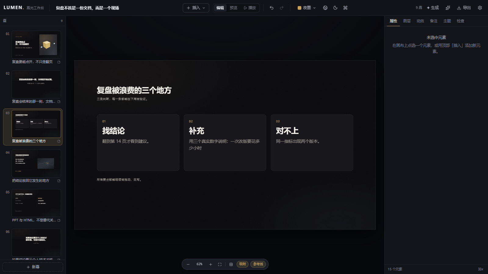

<p align="center"><sub>1600×900 画布：缩放、吸附与参考线就绪；选中元素后可多选 / 框选、八向缩放、旋转、对齐分布与锁定隐藏。</sub></p>

AI 只产出结构——大纲、槽位、场景描述——每一块都还能继续被拖动、改写、换主题。画布不是预览器，而是真正的编辑器：

- **六种块**：`text` `shape` `image` `svg` `three` `html`（沙箱 iframe），同一页里任意混排；
- **手改细节**：内联改字、检查器精确数值、图层排序、锁定隐藏、200 步撤销与重做；
- **单页重写**：只挑一页让 AI 重写文案、精简字数、改成时间轴，或单独补一张 SVG / 一个 3D 视角，不用整份推倒重来。

## 表达：SVG 与 3D 是一等公民

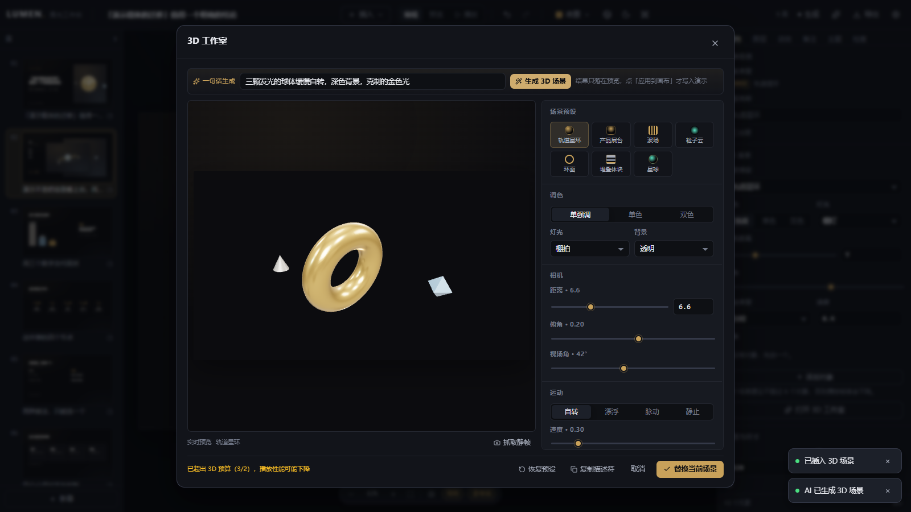

SVG 与 three.js 在这里不是「插入的素材」，而是演示的两种正式语言：

- **SVG**：矢量的默认形态，换主题自动换色；AI 生成的 SVG 会经过白名单净化与颜色令牌化，任意主题下都成立；播放时支持描边生长、漂浮、呼吸等动效。
- **3D**：不是装饰，是记忆点。受限的场景描述符（预设 + 形体 + 材质 + 灯光 + 运动）换来确定性、性能与可导出；3D 只在当前幕运行，离屏即停，缩略图不创建 WebGL 上下文。

## 开演：转场、讲者视图与排练

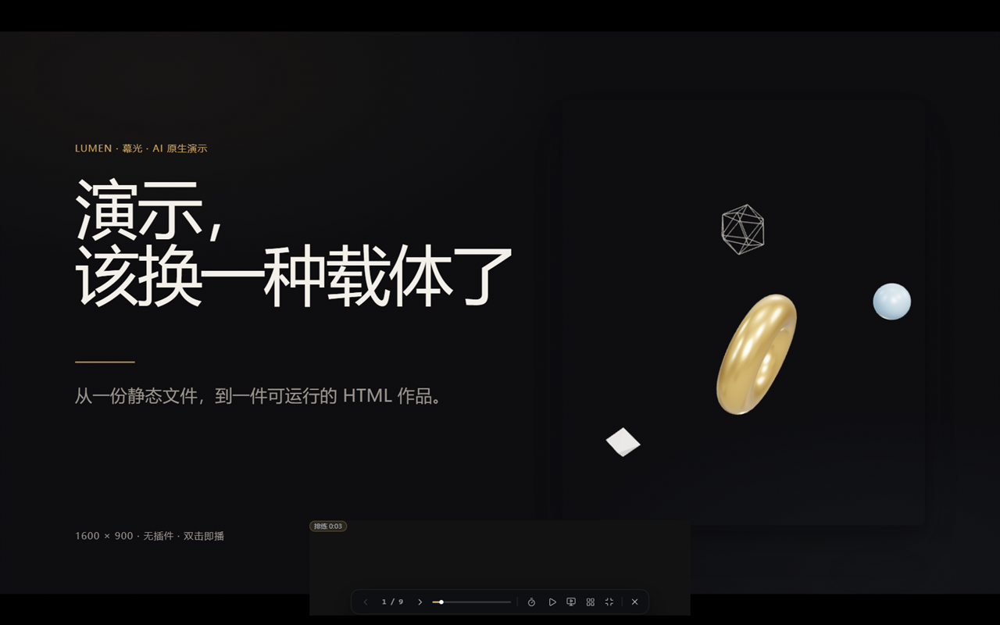

<p align="center"><sub>v0.4.0 播放台：全屏、排练计时、自动播放、讲者视图与总览，一条控制条全都在。</sub></p>

- **转场**：四种动画转场（淡入 / 推入 / 擦除 / 3D 翻转）+ 直切，共五种选择；
- **讲者视图**：备注 + 计时 + 下一幕预告，一边控场一边看时间；
- **排练计时**：彩排时就知道自己有没有超时，上台前心里有数；
- **黑屏与总览**：临时静场，随时跳到任意一幕；
- **自动播放**：展台循环或无人值守演示；
- **翻页器**：主流翻页笔即插即用。

## 交付：一个 HTML 文件带走

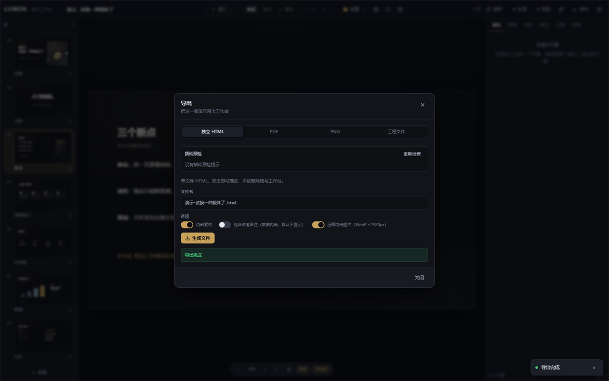

导出的独立 HTML 与编辑器同源，播放器内核与素材全打包在里面，`file://` 双击即播（e2e 实测零外部请求）；`?print=1` 直接打印成 PDF。同一条导出管线还能给你：

| 格式 | 用途 |
| --- | --- |
| **独立 HTML** | 单文件、可离线、可托管；可选内联素材与讲者备注，整份或当前幕 |
| **PDF** | 应用内打印路由，逐幕渲染，3D 幕先抓帧 |
| **逐幕 PNG** | 默认 2× 高清位图；导出前列出缺失素材与失败页，可只重试失败页 |
| **`.lumen.json`** | 工程文件（含素材），换台电脑继续改 |

体积也替你想过：内联前的大图会重采样到 ≤1920px WebP（质量 0.82），只有确实变小才替换；导出前预检会点名缺失的素材页。

## 通道：接你自己的模型，也留了离线退路

- **Mock**：默认离线通道，确定性样张，不用配置任何密钥就能把整套流程跑一遍；
- **OpenAI 兼容**：流式 SSE、退避重试、响应缓存；内置预设覆盖 DeepSeek、OpenAI、本地 Ollama、自建网关与自定义端点；
- **Replay**：把真实模型录制下来的完整演示离线回放，`?channel=replay&speed=0` 零等待；
- 端点与密钥只存在你自己的浏览器里，不随导出的文件走。

## 改造一：插件（v0.4.0 新增）

插件是**本地包**，不是云端服务。一个 `.lumenplug` 就是 UTF-8 JSON 信封（manifest + files + 完整性校验）：文件选择、拖到窗口任意位置、从链接安装三条路都能装。

| 插件页：三款内置样例 | 插件管理：权限逐项可见 |
| :---: | :---: |
| 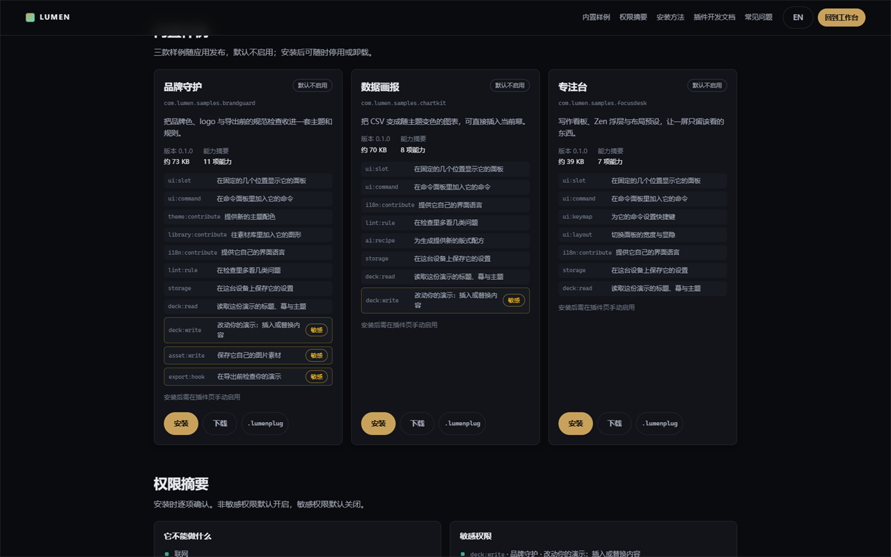 | 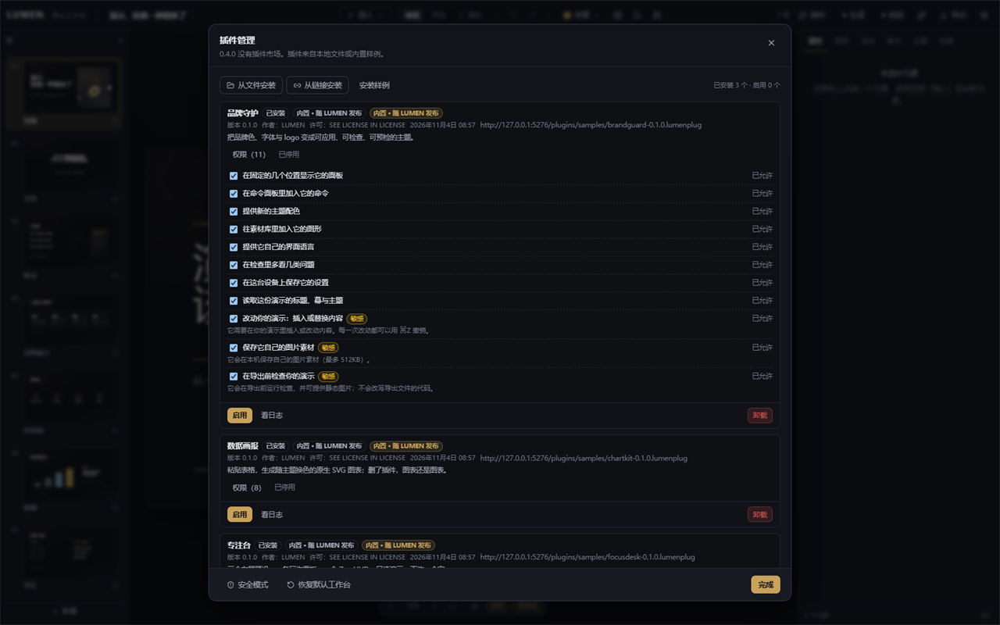 |
| <sub>能力、体积、敏感权限一眼看清，一键安装或下载</sub> | <sub>已装列表、每项权限与「敏感」标记、启用 / 卸载 / 看日志</sub> |

- **两种形态**：声明式（纯 JSON，宿主原生渲染，零代码执行）与代码式（manifest + 单文件 ESM，无构建、无 JSX、无外部 import）；
- **15 项能力、9 个插槽、4 项敏感能力**：安装时逐项列出、可逐项开关；`ai:invoke` / `deck:write` / `asset:write` / `export:hook` 默认不勾选，需要二次确认；
- **安全边界**：代码只跑在不透明源的 `<iframe sandbox="allow-scripts">` 里，拿不到宿主 DOM、Cookie 与 IndexedDB；iframe CSP 是 `connect-src 'none'`——**插件不能联网**、不能读你的文件、不能读其他插件的数据；
- **可管理**：安装确认卡先讲清「能做什么、不能做什么」；本地审计日志（环形 200 条）、连续 3 次启动失败自动隔离、`?safe=1` / `#safe` 或启动时按住 `Shift` 进入安全模式、输入 `RESET` 恢复默认工作台（演示内容不动）。

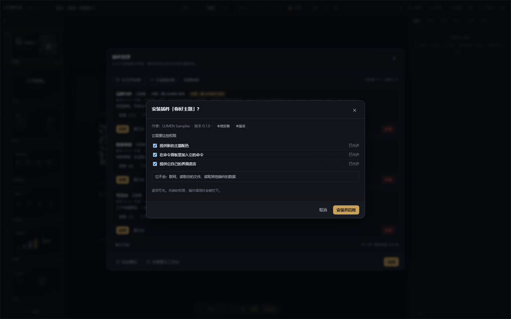

<p align="center"><sub>未签名也照实展示权限；「它不会：联网、读取你的文件、读取其他插件的数据」。</sub></p>

三款内置样例默认不启用，打开 [plugins.html](plugins.html) 一键安装，之后到顶栏「插件」里手动开启：

| 样例 | 做什么 |
| --- | --- |
| **品牌守护 BrandGuard** | 3 套品牌主题、品牌素材、4 条检查规则、导出前品牌预检 |
| **数据画报 ChartKit** | CSV / TSV / JSON → 柱状 / 折线 / 环形 / 堆叠原生 SVG 图表，跟随主题换色，图表落成标准 SVG 块 |
| **专注台 FocusDesk** | 3 个布局预设、写作看板与 Zen HUD；不申请 `deck:write`，只读演示、不改一个字 |

## 改造二：创造模式（v0.4.0 新增）

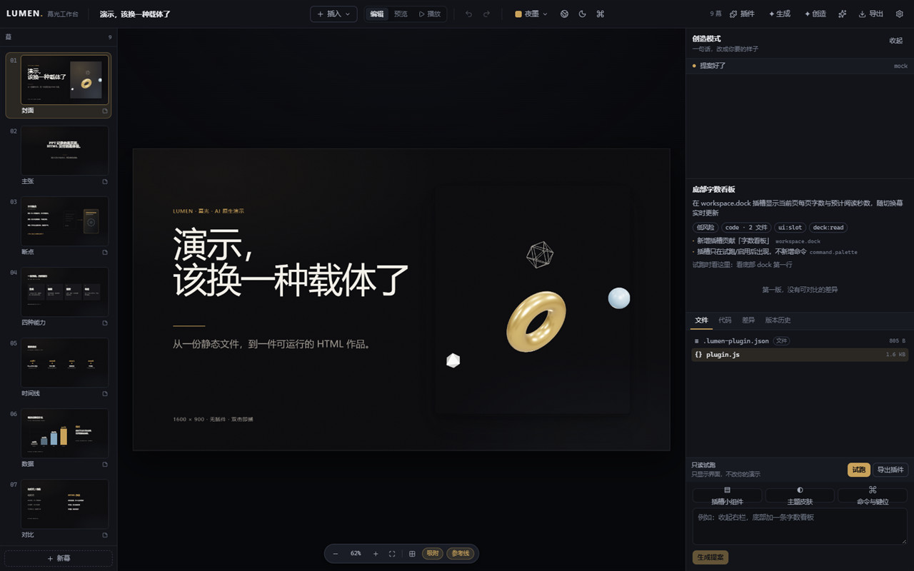

创造模式是宿主内置功能，不是插件：**一句话 → 提案 → 沙箱试跑 → 保留 / 撤销 → 导出插件**。

1. **说一句**：写清位置和效果，例如「把右侧栏收起来，底部加一条字数看板」。
2. **看提案**：摘要、风险级别、改动点、文件树、只读代码、行级 diff 与最近 10 版历史；与 manifest 不一致或越出可改范围会被拦下。
3. **试跑**：草稿在当前工作台热挂载，画布仍可操作。默认只读，只有提案申请 `deck:write` 时才出现「允许改演示」开关，打开它还要二次确认；试改一律走事务，撤销按事务回滚。
4. **保留 / 撤销 / 导出**：保留后以本地插件身份安装，走同一套 ABI 与能力校验；满意就导出 `.lumenplug`，与安装管线共用同一套包格式与 sha256 口径。

没有模型也能用：起步卡提供 3 个模板（主题皮肤 / 插槽小组件 / 命令与键位），同步生成提案、不调模型。入口有四个：顶栏「✦ 创造」、命令面板（`⌘/Ctrl + K` → `creator.open`）、`⌘/Ctrl + ⇧ + K`、`?creator=1`。有模型时 repair 最多 2 轮并回喂试跑错误，但**不承诺成功率**，失败会给下一步。

## 九幕样张

一套示例演示的九个切面——同样的内容，九种讲法：

| 封面 | 主张 | 对开 |
| :---: | :---: | :---: |
| 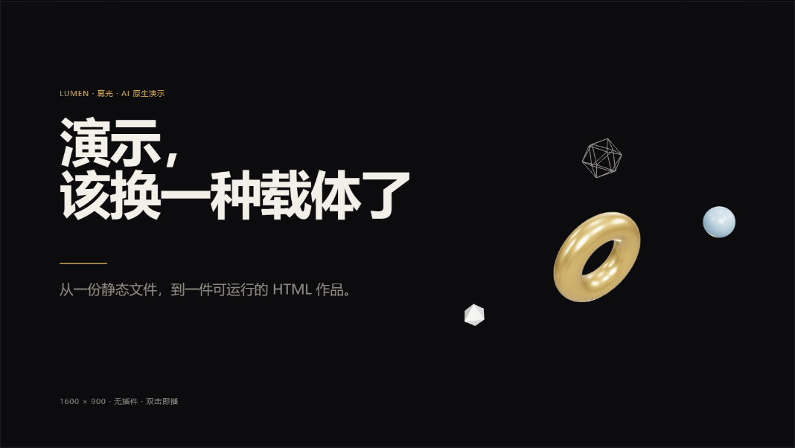 |  | 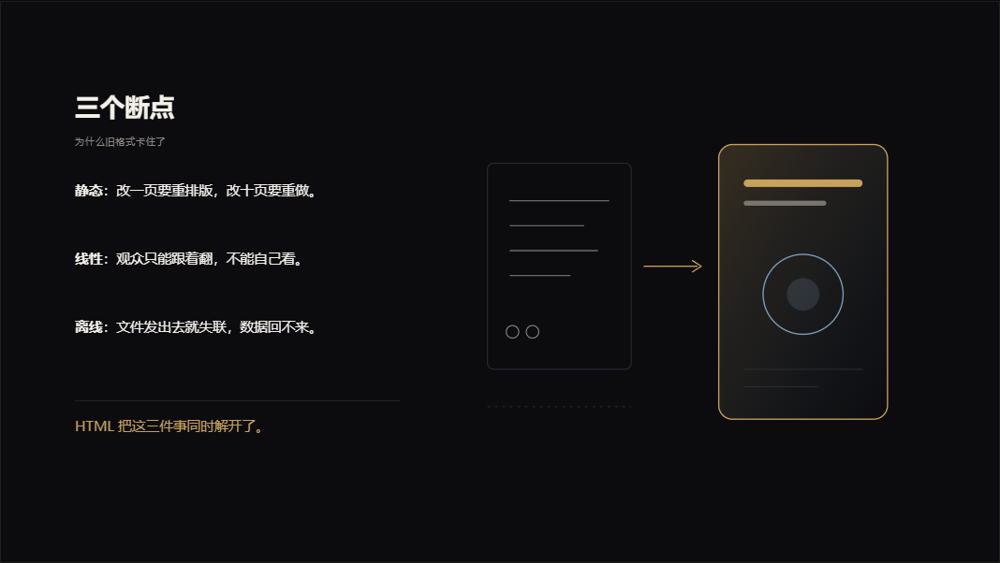 |

| 四格 | 时间线 | 数据 |
| :---: | :---: | :---: |
| 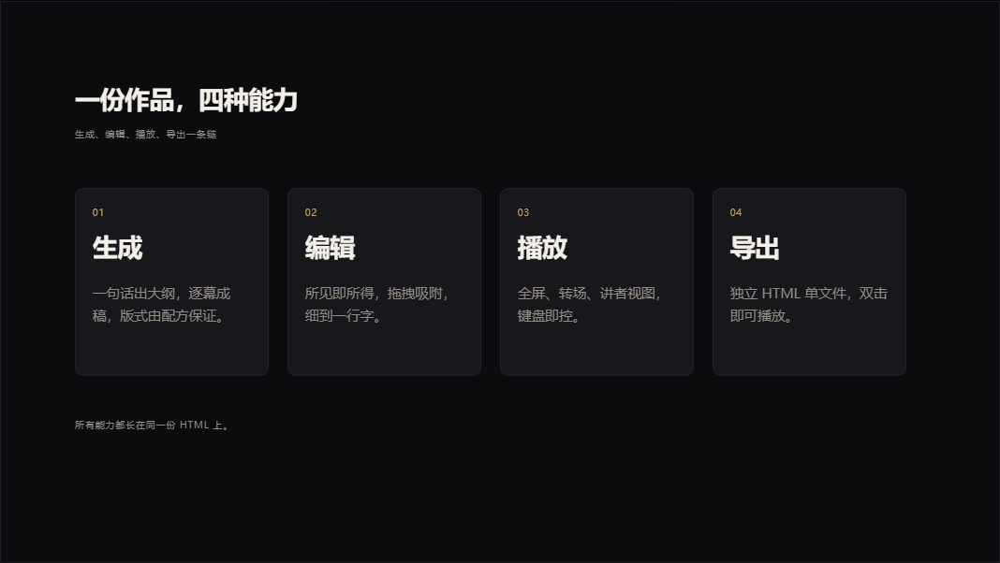 | 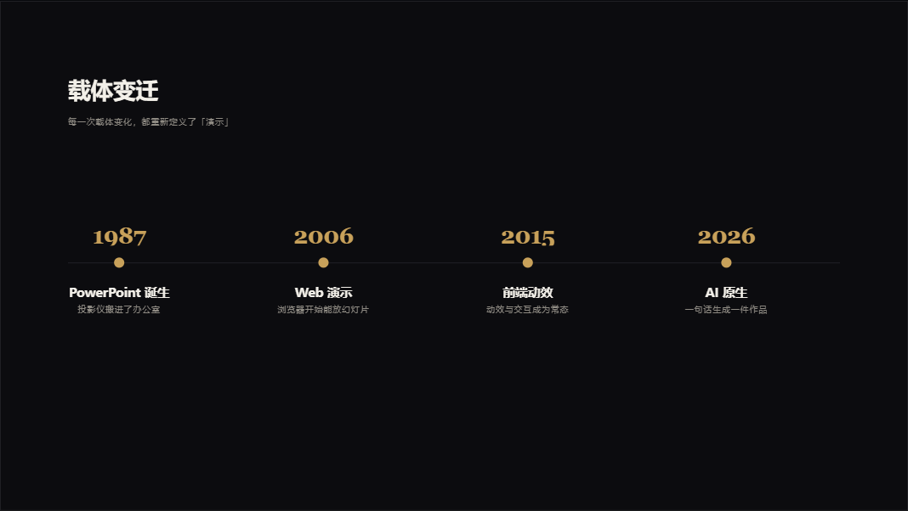 |  |

| 对照 | 引语 | 落幕 |
| :---: | :---: | :---: |
| 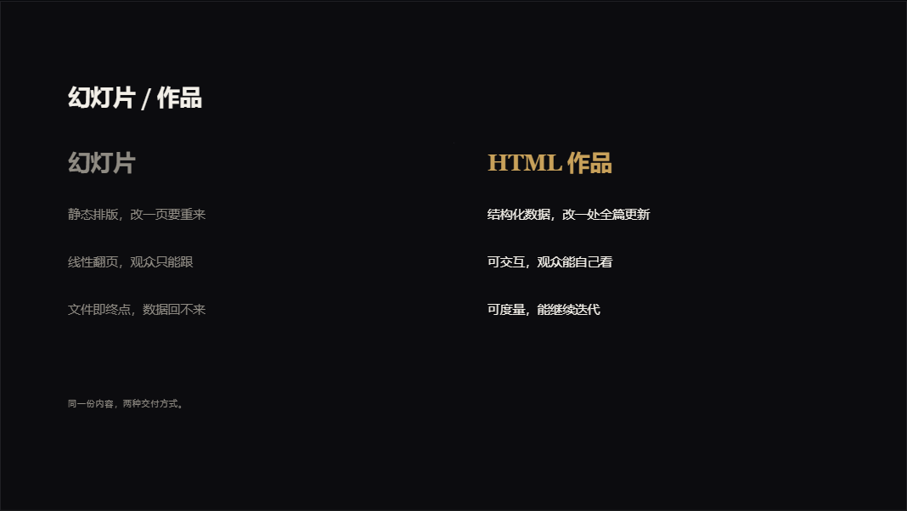 |  | 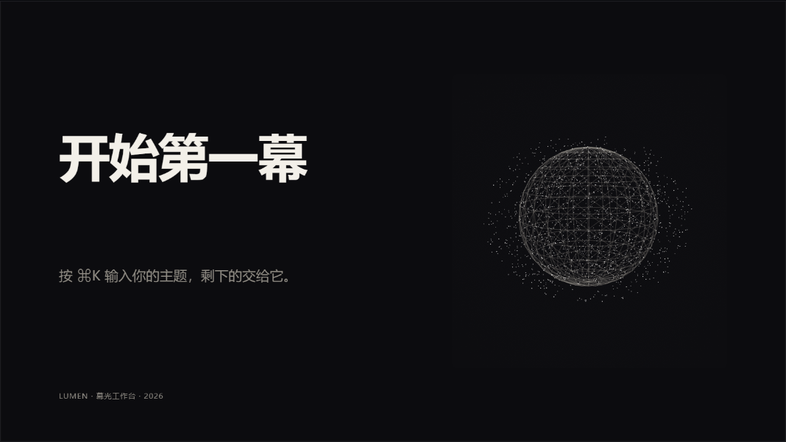 |

## 门户与首启

| 门户 v0.4.0 | 首启三步 |
| :---: | :---: |
| 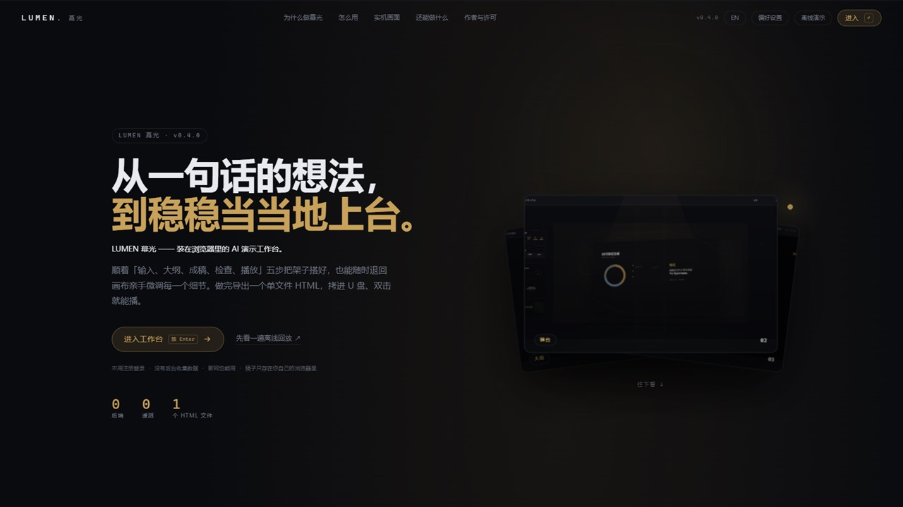 | 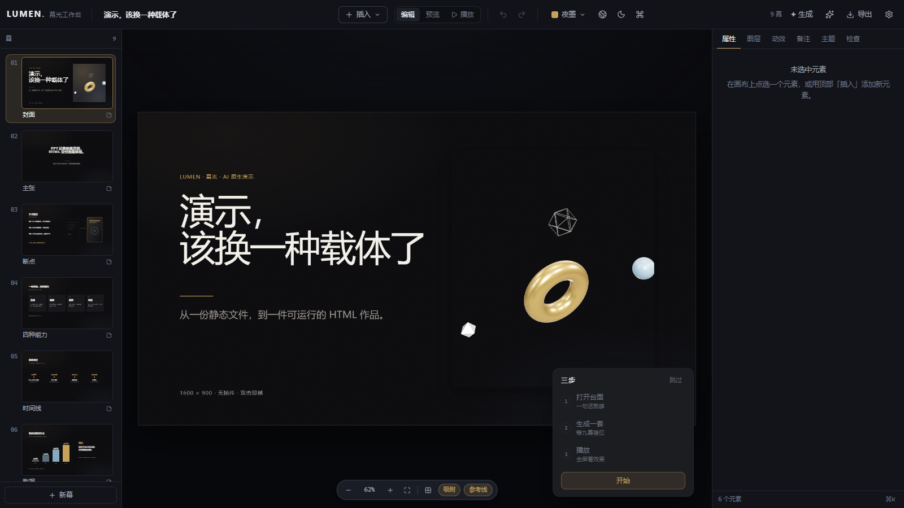 |
| <sub>独立入口 `portal.html`：主张、五步、实机画面、偏好设置与作者许可</sub> | <sub>第一次进入时右下角的三步小卡：打开台面 → 生成一套 → 播放</sub> |

<p align="center"><sub>截图以中文界面为主；界面支持中 / 英一键切换。</sub></p>

<p align="center"><sub>除封面概念插画外，本文截图均取自真实界面；编辑器、播放、编排与九幕样张可用 <code>pnpm snapshot</code> 重拍（输出到 <code>harness/out/</code>）。</sub></p>

## 快速开始

```powershell
pnpm install        # 依赖
pnpm dev            # 先构建播放器内核与样例插件，再起 vite（端口固定 5273）
# → http://127.0.0.1:5273
```

```powershell
pnpm test           # vitest（jsdom）
pnpm typecheck      # tsc --noEmit
pnpm lint:i18n      # 中英词条对等
pnpm e2e            # Playwright（自动拉起 5274 的 dev server）
pnpm build          # tsc + vite build → dist/
```

<details>
<summary><b>没有 pnpm？直连写法 / 离线回放地址 / 更多脚本</b></summary>

```powershell
# 直接调用 node_modules 里的入口（本仓库的验收就是这么跑的）
node node_modules/vitest/vitest.mjs run
node node_modules/typescript/bin/tsc --noEmit
node node_modules/@playwright/test/cli.js test

# 离线回放：零外网请求，完整放完一套演示
# http://127.0.0.1:5273/?channel=replay&speed=0
# http://127.0.0.1:5273/?still=1&channel=replay&speed=0   # 再叠一层 L0（截图 / e2e）

pnpm test:security  # 安全红队（独立配置）
pnpm pack:plugins   # 重新打包三款 .lumenplug
pnpm snapshot       # 截图到 harness/out/
```

</details>

> 开发地址 `http://127.0.0.1:5273`；门户 `http://127.0.0.1:5273/portal.html`；插件页 `http://127.0.0.1:5273/plugins.html`。

## 隐私与本地优先

- **工作台本身是纯静态前端**：没有后端、没有遥测、没有远程字体；断网可用（Mock / Replay 两条离线通道）。
- 数据只在本地 IndexedDB（单库 `lumen-deck`，DB v4，八个 store）；清站点数据即清全部。
- 模型端点与密钥由你自己填，只存在本地设置里；导出的 `.lumen.json` 与独立 HTML 都不含端点与密钥。
- 插件数据也只在本地：插件不能联网，数据不进 deck；卸载默认删除插件数据（可勾选保留）。
- 诊断 JSON 需要你在设置里手动导出并自行发送——**这正是「无遥测」的代价**。
- 仓库另带一个可选的 Edge CORS 转发模板（`api/llm-proxy.ts`），只在浏览器直连被 CORS 拦截时使用：它不进入前端构建产物，但部署到 Vercel 时会作为 Edge Function 一并发布，不需要可以删掉这个文件。

## 技术栈与工程化

| 层 | 选型 |
| --- | --- |
| 视图 | React 19.2 · TypeScript 5.9（strict）· Vite 7.3 |
| 状态 | zustand 5 + immer 11（补丁历史，200 步） |
| 契约 | zod 3.25（`src/schema/deck.ts` 是唯一数据契约） |
| 3D | three r186（按需动态加载，缩略图不建 WebGL） |
| 其它 | DOMPurify 3（SVG 净化）· CodeMirror 6（SVG/HTML 编辑）· 自建 IndexedDB 封装（`kv.ts`） |
| 测试 | vitest 48 文件 / 1,028 例 + 安全红队 6 文件 / 38 例；Playwright 16 spec / 49 例（采样 2026-11-04） |

- **CI**：GitHub Actions 三个 job —— verify（typecheck / test / build / 样例包一致性 / 体积护栏）、e2e、security 红队。
- **护栏**：首屏体积与懒加载检查（`scripts/budget-check.mjs`，gzip 增量 ≤ 45 KB），插件运行时 / 管理 / 创造模式必须是独立 chunk。
- **部署**：纯静态，`pnpm build` → `dist/`，无 SSR、无环境变量；PWA 可安装、可离线。
- **端到端实战**：`simulation/` 内含零依赖的模拟 OpenAI 兼容端点与 Playwright 驱动，用真实浏览器 + 真实 SSE + 真实 IndexedDB 跑通全链路（`pnpm sim:llm`）。
- **双语**：UI 中 / 英即时切换，1,627 条词条 × 2 语言严格对等（`pnpm lint:i18n`）。

## 项目结构

<details>
<summary><b>展开目录树</b></summary>

```text
src/
├─ schema/ state/ persistence/ themes/ styles/   # 契约、状态、存储、主题、令牌
├─ render/                                       # 唯一渲染器（stage/play/thumb/print/export）
├─ editor/                                       # 画布交互、幕栏、检查器、工具栏、快捷键
├─ ai/                                           # provider、通道（mock/openai/replay）、prompts、配方、大纲/微调
├─ forge/                                        # 造幕台：状态机、五段舞台、卡面、HUD、降级档、游戏层、演出节奏
├─ plugins/                                      # 插件运行时：包/清单/能力、iframe 宿主、RPC、声明式贡献、SDK
├─ creator/                                      # 创造模式：状态机、提案、diff、试跑、模板、导出 .lumenplug
├─ pages/plugins/                                # plugins.html：三款样例安装卡与权限摘要
├─ onboarding/ portal/                           # 首启三步 / 独立门户（portal.html）
├─ fixtures/ai/                                  # replay 的离线 fixture
├─ studio/                                       # SVG / 3D 工作室与精选库
├─ play/ player/                                 # 播放器与播放器内核入口（IIFE 构建）
├─ export/                                       # 独立 HTML、打印/PDF、PNG、工程文件
├─ ui/ i18n/ sample/ version.ts                  # 基元、文案、9 幕示例、版本号唯一来源

plugins/builtin/                                  # 三款样例源码（打包为 .lumenplug）
tests/unit/  tests/e2e/  tests/security/          # 纯逻辑 / Playwright / 安全红队
scripts/                                          # dev server、播放器构建、截图 harness、样例打包、体积护栏
doc/screenshots/                                  # README 截图与品牌图（文档正文只在本地）
```

</details>

## 文档与部署

- 设计与契约文档（`00` 工程契约 … `13` 创造模式）与每版的 `plan/` 证据包**只在本地工作副本保留，不随仓库发布**；面向使用者的变化摘要都在 [CHANGELOG.md](CHANGELOG.md)。要看这些文档请向作者索取。
- 纯静态产物：`pnpm build` → `dist/`（三个 HTML 入口：`index.html`、`portal.html`、`plugins.html`）。仓库随带 [`vercel.json`](vercel.json)，Vercel 导入即可（Framework 认 Vite，Node 选 22.x）。

```powershell
pnpm run deploy:preview   # 预览部署 → *.vercel.app
pnpm run deploy:prod      # 生产部署
```

> 必须走 `pnpm run`：`pnpm deploy` 是 pnpm 内建的 workspace 部署命令，会盖掉同名脚本。

## 许可

源码采用 **Apache-2.0 + Commons Clause**（可另选 **FSL-1.1-MIT**）的 source-available 双轨授权；设计与示例资产仍为 **CC BY-NC 4.0**。`v0.2.0` 及更早版本保持历史 `CC BY-NC 4.0` 不变。

- **你可以**：自建、内部部署、修改、二次开发、嵌入更大的产品，用于教学与研究；Apache-2.0 的专利授权继续有效。
- **你需要**：保留版权与许可声明；分发衍生作品时附上 [`LICENSE`](LICENSE) 与 [`NOTICE`](NOTICE)。
- **你不可以**：转售 LUMEN 本身或改名后的等价物、把示例文案 / 截图 / 品牌资产用于商业交付、把 LUMEN 名称与 Logo 当作自己的品牌。
- 需要「版本发布满两年自动转为 MIT」的确定性？改用 [`LICENSE-FSL-1.1-MIT.md`](LICENSE-FSL-1.1-MIT.md)，两条路径二选一。

完整文本与边界：[`LICENSE`](LICENSE) · [`LICENSE-FSL-1.1-MIT.md`](LICENSE-FSL-1.1-MIT.md) · [`LICENSE-CC-BY-NC-4.0.txt`](LICENSE-CC-BY-NC-4.0.txt) · [许可导读](LICENSING.md) · [商标说明](TRADEMARK.md)。商业授权请联系 [lzytttttt@gmail.com](mailto:lzytttttt@gmail.com)。

> Commons Clause 使本项目属于 source-available（源码可用）而非 OSI 开源；请勿在宣传中称其为 "open source"。

---

<p align="center">
  
  <br />
  <sub><b>LUMEN 幕光</b> · 用一句话，把想法送上台。</sub>
  <br />
  <sub>作者 <a href="https://github.com/lzytttttt">无极Ayaya</a> · <a href="https://github.com/lzytttttt/LUMEN">github.com/lzytttttt/LUMEN</a> · <a href="mailto:lzytttttt@gmail.com">lzytttttt@gmail.com</a></sub>
  <br />
  <sub>贡献见 <a href="CONTRIBUTING.md">CONTRIBUTING.md</a> · 安全问题请私下邮件，见 <a href="SECURITY.md">SECURITY.md</a></sub>
</p>
