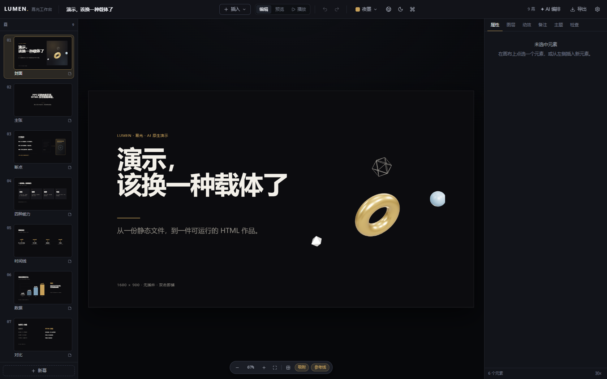
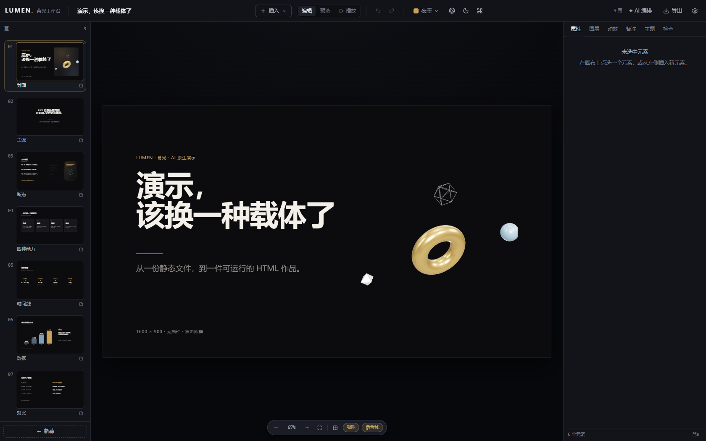
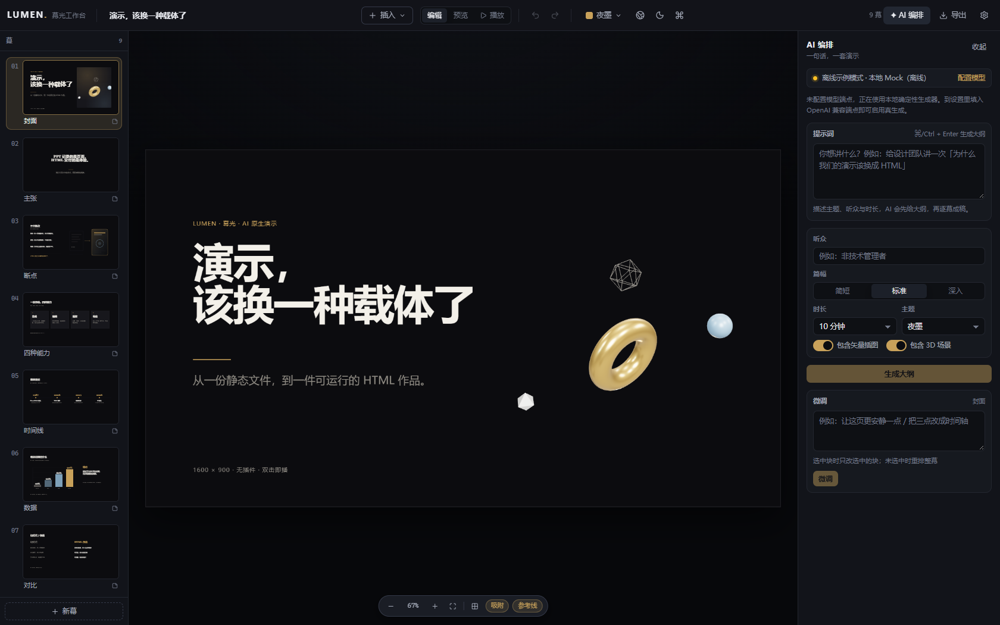
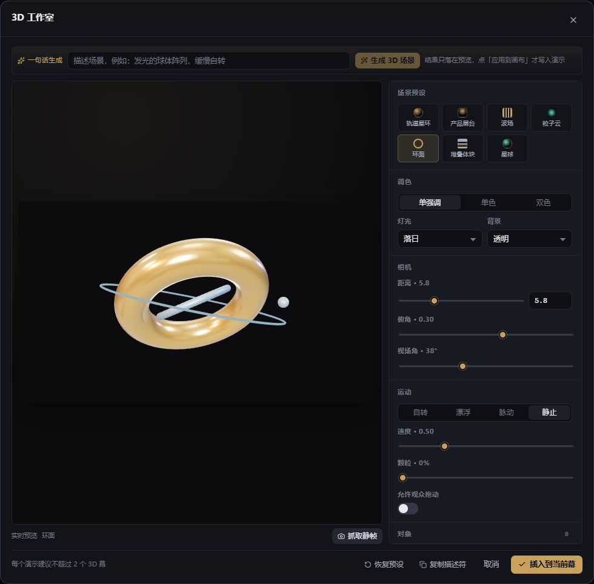
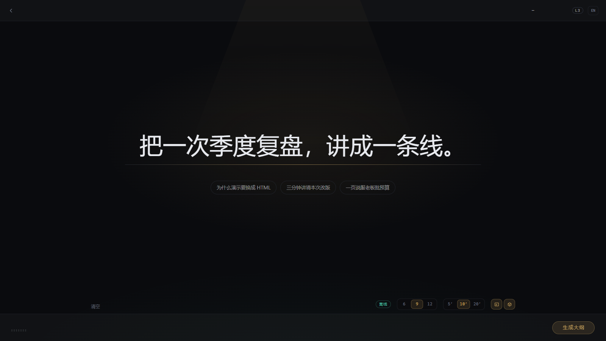
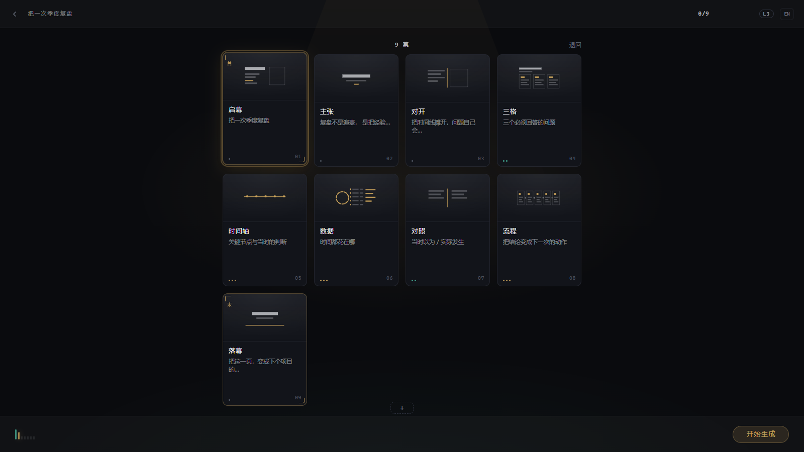
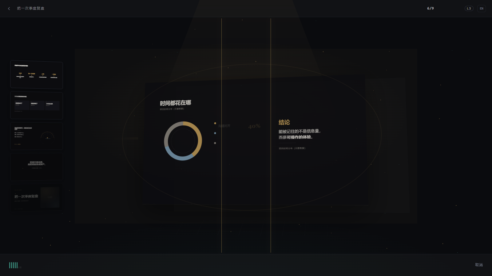
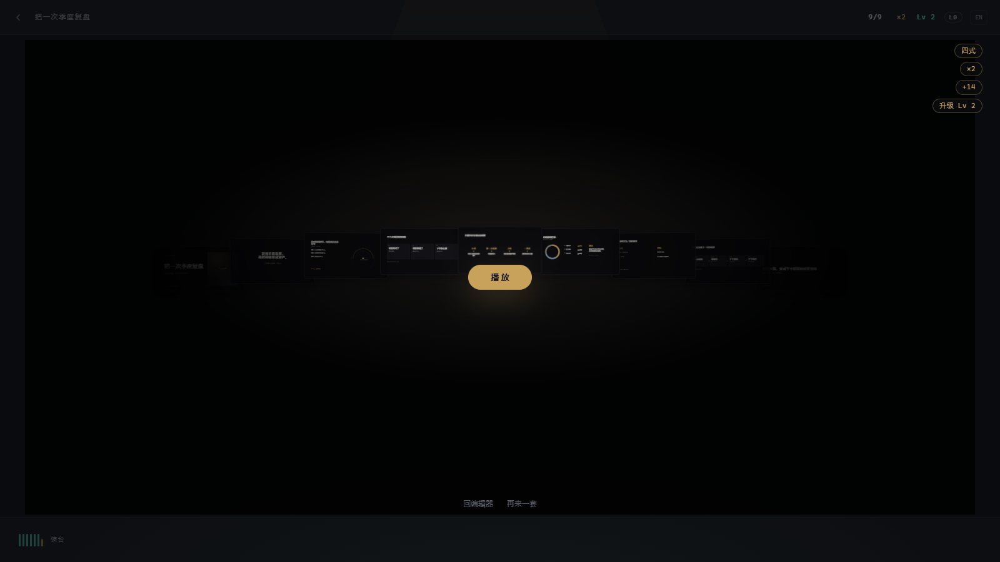
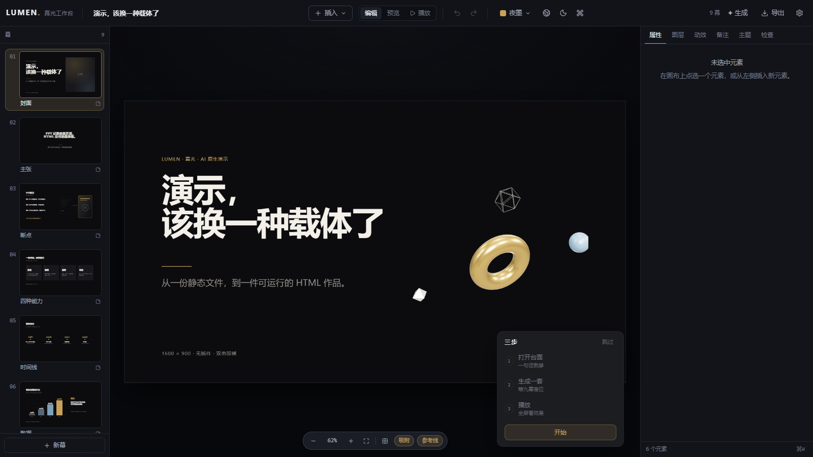

# LUMEN 幕光

**浏览器里的 AI 原生演示工作台。** 从造幕台开始：一句话 → 大纲 → 成稿 → 检查 → 播放，五段在同一个台面上走完；画布上继续改，最后导出一个双击就能播的单文件 HTML。

**An AI-native deck workbench in the browser.** Start at the Forge: prompt, outline, build, check, play — five stages on one stage. Keep editing on a real canvas, then ship a single self-contained HTML file that plays on double-click.

**版本 / Version: [v0.2.0](https://github.com/lzytttttt/LUMEN/releases/tag/v0.2.0)** — 造幕台版本（Forge）。

作者 / Author：**无极Ayaya** · 项目：[github.com/lzytttttt/LUMEN](https://github.com/lzytttttt/LUMEN) · 联系：[lzytttttt@gmail.com](mailto:lzytttttt@gmail.com) · 许可：[CC BY-NC 4.0](https://creativecommons.org/licenses/by-nc/4.0/)

> 本仓库没有后端、没有遥测、没有外链字体：数据在 IndexedDB，模型端点由你自己填（含本地 Ollama），默认离线 Mock；`?channel=replay` 可以完全离线地把一整套演示放完。

## 门户 / Portal

独立入口 `portal.html`（构建产物同样是 `dist/portal.html`，可单独托管；开发地址 `http://127.0.0.1:5273/portal.html`，也可以 `?portal=1`）。工作台左上角的 `LUMEN` 品牌可随时回门户。

门户是一张瀑布式长页：主张 → 为什么（四个真实顾虑）→ 五步造幕台 → 五种真实界面窗口 → 六项能力 → 偏好设置与最终召唤 → 作者与许可。它不加载编辑器与渲染器，只依赖设置与文案；设置抽屉里的生成通道 / 接口预设 / 画面档位 / 声音 / 减少动效 / 界面语言直接写 `lumen.prefs`，进入工作台后立即生效。`Enter` 进入工作台。

作者头像是 GitHub 同款（[@lzytttttt](https://github.com/lzytttttt)）。作者：**无极Ayaya** · 项目：[github.com/lzytttttt/LUMEN](https://github.com/lzytttttt/LUMEN) · 联系：[lzytttttt@gmail.com](mailto:lzytttttt@gmail.com) · 许可：[CC BY-NC 4.0](https://creativecommons.org/licenses/by-nc/4.0/)

## 首启 / First run

首次打开工作台（`settings.onboarded === false`）右下角出现三步小卡：**打开台面 → 生成一套 → 播放**。点「开始」会打开造幕台并预填一句示例，之后每步都由真实动作点亮；不写引导长文、不做遮罩、不拦画布。点「跳过」即写入 `onboarded`。`?onboard=1` 可强制回放，`?onboard=0` 可隐藏。

## 造幕台 / The Forge

四个入口都走同一个事件：顶栏「✦ 生成」、命令面板（`⌘/Ctrl + K` → `forge.open`）、画布空态 CTA、左侧幕栏「+」**长按 400ms**（短按仍是新建空白幕）。`Esc` 随时退出，已完成的幕立刻落进左侧幕栏，一次撤销回到造幕前。

| 段 | 屏幕上看到的 | 你能做什么 |
|---|---|---|
| 输入 | 一句话 + 三张示例卡 + 幕数/时长/视觉开关 | 空输入时主按钮不可点；示例卡只填入、不提交 |
| 大纲 | 9 张幕卡（3–20 幕） | 换一张、删一幕、加一幕、拖动换序；首末两幕锁定 |
| 生成 | 进度 `3/9`、连击 `×4` | 逐幕成稿，随时取消；取消不落库 |
| 检查 | 卡点（error）与星标（warn） | error 触发一次兜底重排；仍不过就「重试」这一幕；卡住期间不出现播放入口 |
| 播放 | `播放` / `编辑` | 全屏播放，`Esc` 回画布；「再来一套」重开 |

**演出节奏**：生成不是"越快越好"。造幕台把管线事件按 mock 样张的时间线排队落位——输入最少停留 640ms、相邻两幕 560ms、最后一幕到开演席 560ms、重铸 760ms（`src/forge/pacing.ts`）。快模型（本地 Mock）与真端点都会得到同一套节拍；`?still=1` 与 `?channel=replay&speed=0`（截图 / e2e）为 0 等待。

- **降级档 L0–L3**：一次判定、只降不升，可在设置里锁档（L0 静态 / L1 流水线 / L2 2.5D / L3 全动效）。`?still=1` 强制 L0，视觉基线与低端机都走这一档。
- **游戏化**：连击（上限 ×6）、熟练度（Lv 1–12）、成就，全部本地计算，零阻塞、零网络、不解锁任何功能。
- **键盘**：`Tab` 在台面内循环，`Enter` 提交/进入，`←/→` 选卡，`Alt+↑/↓` 换位，`Del` 删幕，`R` 重试卡住的那一幕，`Esc` 退出。

### 设置 / Settings

顶栏「设置」里新增造幕台段：档位（自动 / L0–L3）、玩法（简 / 全）、音效、自动播放、流式开关、重置进度、导出诊断 JSON。
诊断 JSON（`lumen-diagnostics.json`）由你手动导出，用于反馈问题；应用本身不上报任何数据。

### 离线回放 / Offline replay

```text
http://127.0.0.1:5273/?channel=replay&speed=0      # 回放 fixture，零外网请求
http://127.0.0.1:5273/?still=1&channel=replay&speed=0   # 再叠一层 L0（截图与 e2e 用）
```

`?speed=0` 同步灌帧、不做逐帧等待；回放数据在 `src/fixtures/ai/<setId>/*.json`（默认 `zh-normal`），由真实模型录制。
`?strict=0` 关闭 `promptDigest` 严格匹配，按 task 顺序兜底（演示用）。

## 截图 / Screenshots

> 截图取自 `node scripts/snapshot.mjs http://127.0.0.1:5273`（原始输出在 `harness/out/`，不入库），
> 定型后拷贝到 `doc/screenshots/` 随仓库发布。造幕台五态用 `?still=1` 拍，避免动效中间帧。

| 编辑器 / Editor | 播放 / Play |
|---|---|
|  |  |

| 精确模式 / Composer | 工作室 / Studio |
|---|---|
|  |  |

造幕台 / Forge（v0.2.0 实机截图，`?still=1` 拍摄）：

| 输入 | 大纲 |
|---|---|
|  |  |

| 生成（装台 + 过检） | 播放 |
|---|---|
|  |  |

| 门户 / Portal | 首启三步 / First run |
|---|---|
|  |  |

逐幕截图 / Slides：[01](doc/screenshots/slides/slide-01.png) · [02](doc/screenshots/slides/slide-02.png) · [03](doc/screenshots/slides/slide-03.png) · [04](doc/screenshots/slides/slide-04.png) · [05](doc/screenshots/slides/slide-05.png) · [06](doc/screenshots/slides/slide-06.png) · [07](doc/screenshots/slides/slide-07.png) · [08](doc/screenshots/slides/slide-08.png) · [09](doc/screenshots/slides/slide-09.png)（示例 9 幕）

## 能力 / Capabilities

- **造幕台**：五段闭环；12 张幕卡配方、首末锁、加/删/换序/重试；进度与取消都是真值，取消不落库。
- **生成**：提示 → 可编辑大纲 → 逐幕成稿；12 个版式配方 × 6 套主题；单幕重写、精简、时间轴化、加 SVG / 加 3D。
- **通道**：Mock（离线确定性）/ OpenAI 兼容（流式 SSE、退避重试、响应缓存）/ Replay（离线回放）；预设档覆盖 DeepSeek、OpenAI、Ollama、自建网关。
- **编辑**：1600×900 画布、多选/框选、八向缩放、旋转、智能参考线 + 网格吸附、对齐分布、图层、锁定隐藏、内联改字、200 步撤销。
- **六种块**：`text` `shape` `image` `svg` `three` `html`（沙箱 iframe）。
- **播放**：全屏、5 种转场、讲者视图（备注 + 计时 + 下一幕）、总览、自动播放、翻页器。
- **导出**：单文件 HTML（`file://` 可播、`?print=1` 打 PDF）、PDF、逐幕 PNG、`.lumen.json` 工程文件。
- **过检**：溢出 / 对比度 / 字号 / 3D 预算 / 阅读时长统一 lint；AI 产物与人工产物同一把尺子，error 在造幕台上变成看得见的卡点。
- **双语**：UI 中/英即时切换（1,088 个键 × 2 语言，键必须对等）。

## 5 分钟上手 / Quick start

```powershell
# 1) 依赖（本机用的是仓库外的 bundled pnpm；常规环境直接用 pnpm install）
pnpm install

# 2) 开发（先构建播放器内核，再拉 vite；端口固定 5273）
pnpm dev            # → http://127.0.0.1:5273

# 3) 单个动作（等价于直接调用 node_modules 里的入口，见 doc/09）
pnpm test           # vitest（jsdom）
pnpm typecheck      # tsc --noEmit
pnpm lint:i18n      # zh/en 键对等
pnpm snapshot       # 截图到 harness/out/
pnpm e2e            # Playwright（自动拉起 5274 的 dev server）

# 4) 生产构建（tsc + vite build，prebuild 会先构建播放器内核）
pnpm build
```

**没有 pnpm 时的直连写法**（本仓库的验收就是这么跑的）：

```powershell
node node_modules/vitest/vitest.mjs run
node node_modules/typescript/bin/tsc --noEmit
node node_modules/@playwright/test/cli.js test
```

**导出**：顶栏「导出」→ 独立 HTML（可选内联素材/备注、整份或当前幕）/ PDF（应用内打印）/ PNG（逐幕，默认 2×）/ 工程文件。
导出的 HTML 与播放器内核同源：`public/player/lumen-player.js` 是构建产物，换机器先 `pnpm build:player`。

## 隐私 / Privacy

- 没有后端、没有遥测、没有远程字体；断网可用（Mock / Replay 两条离线通道）。
- 数据只在本地 IndexedDB（单库 `lumen-deck`，DB v3：`decks` / `assets` / `settings` / `forge` / `aiCache`）。清站点数据即清全部。
- 模型端点与密钥由你自己填，只存在本地设置里；导出的 `.lumen.json` 与独立 HTML 都不含端点与密钥。
- 诊断 JSON 需要你在设置里手动导出并自行发送——这正是「无遥测」的代价。
- 游戏进度硬上限 6KB（单键 `forge/progress`），写入节流 500ms，切后台强制落盘。

## 技术栈 / Stack

| 层 | 选型 |
|---|---|
| 视图 | React 19.2 · TypeScript 5.9（strict）· Vite 7.3 |
| 状态 | zustand 5 + immer 11（补丁历史，200 步） |
| 契约 | zod 3.25（`src/schema/deck.ts` 是唯一数据契约） |
| 3D | three r186（按需动态加载，缩略图不建 WebGL） |
| 其它 | DOMPurify 3（SVG 净化）· CodeMirror 6（SVG/HTML 编辑）· 自建 IndexedDB 封装（`kv.ts`：单库 `lumen-deck` v3 / 五个 store） |
| 测试 | vitest 3（jsdom，19 文件 / 362 用例，采样 2026-10-28）· Playwright 1.64（e2e 8 spec / 14 用例 + 截图 harness） |

## 目录 / Layout

```
src/
├─ schema/ state/ persistence/ themes/ styles/   # 契约、状态、存储、主题、令牌
├─ render/                                       # 唯一渲染器（stage/play/thumb/print/export）
├─ editor/                                       # 画布交互、幕栏、检查器、工具栏、快捷键
├─ ai/                                           # provider、通道（mock/openai/replay）、prompts、配方、大纲/微调
├─ forge/                                        # 造幕台：状态机、五段舞台、卡面、HUD、降级档、游戏层、演出节奏
├─ onboarding/ portal/                            # 首启三步 / 独立门户（portal.html）
├─ fixtures/ai/                                  # replay 的离线 fixture（import.meta.glob 静态打包）
├─ studio/                                       # SVG / 3D 工作室与精选库
├─ play/ player/                                 # 播放器与播放器内核入口（IIFE 构建）
├─ export/                                       # 独立 HTML、打印/PDF、PNG、工程文件
├─ ui/ i18n/ sample/ version.ts                  # 基元、文案、9 幕示例、版本号唯一来源
tests/unit/                                       # 19 文件：纯逻辑、通道契约、文案预算
tests/e2e/                                        # Playwright：编辑/播放/i18n/导出/打印/造幕台
scripts/                                          # dev server、播放器构建、截图 harness
doc/                                              # 设计与契约文档（00–09）
plan/v0.2.0/                                      # 本版的证据与约束（00–09 + 样张 + trace）
```

## 文档 / Docs

| 文档 | 内容 |
|---|---|
| [00 工程契约](doc/00-工程契约.md) | 技术事实、文件所有权、命令、回报格式 |
| [01 产品概述](doc/01-产品概述.md) | 定位、七条 AI 原生原则、四条主线 |
| [02 架构设计](doc/02-架构设计.md) | 模块图、数据流、关键决策、启动流程 |
| [03 数据模型与DSL](doc/03-数据模型与DSL.md) | Deck/Slide/Block/Theme 全字段、栅格、迁移 |
| [04 编辑器](doc/04-编辑器.md) | 画布、命中、拖拽/缩放/旋转、吸附、快捷键 |
| [05 SVG与3D渲染](doc/05-SVG与3D渲染.md) | 渲染契约、three 运行时、SVG/HTML 安全边界、lint |
| [06 AI编排](doc/06-AI编排.md) | 通道与错误码、5 套 prompt、修复环、12 配方、溯源 |
| [07 播放与导出](doc/07-播放与导出.md) | 播放状态机与 5 种转场、讲者视图协议、独立 HTML 组装、PDF/PNG/工程文件 |
| [08 设计系统](doc/08-设计系统.md) | 两套令牌、6 套主题、字号阶、基元、可访问性 |
| [09 开发与验收](doc/09-开发与验收.md) | 命令、测试分层、DoD、常见问题 |
| [plan/v0.2.0](plan/v0.2.0/README.md) | 造幕台的范围、界面、游戏化、动效、LLM 规格与验收矩阵（本版证据） |

## License

本项目以 **Creative Commons Attribution-NonCommercial 4.0 International（CC BY-NC 4.0）** 协议发布。

- 你可以：复制、分发、修改、演绎，用于非商业目的。
- 你必须：署名 **无极Ayaya**、附上协议链接、标明是否修改。
- 你不可以：将本项目或其演绎作品用于商业目的。
- 完整法律文本：[LICENSE-CC-BY-NC-4.0.txt](LICENSE-CC-BY-NC-4.0.txt)；协议主页：<https://creativecommons.org/licenses/by-nc/4.0/>。
- 商业授权请联系：[lzytttttt@gmail.com](mailto:lzytttttt@gmail.com)。

除非某个文件另有说明，本协议适用于整个仓库（源代码、文档与设计资产）。
