# LUMEN v0.3.0 · 模拟 LLM 全链路实战报告

- 运行时间：2026-11-03T00:43:57.314Z → 2026-11-03T00:44:42.848Z（45.5s）
- 页面：http://127.0.0.1:5273?still=1&onboard=0
- 模拟模型：http://127.0.0.1:5299/v1 · `lumen-sim-0.3`
- LLM 请求：34 次 · 任务分布 {"outline":8,"slide":18,"three":4,"svg":3,"refine":1}
- 步骤：19 项 · 失败 0 项
- console error：2（预期内 2 / 预期外 0）· page error：0 · 失败请求：1（预期内 1 / 预期外 0）

## 步骤

| 状态 | id | 说明 | 耗时 | 证据 |
|---|---|---|---|---|
| ✔ | connect | 设置：通道切到模拟端点并测试连通性 | 2426ms | {"endpoint":"http://127.0.0.1:5299/v1","model":"lumen-sim-0.3"} |
| ✔ | forge.outline | 造幕台：一句话 → 9 幕可编辑大纲 | 2066ms | {"cards":9} |
| ✔ | forge.brief | 造幕台：逐幕「这一幕想讲什么」进入生成请求 | 93ms | {"brief":"用三个真实数字说明：一次改版要花多少小时"} |
| ✔ | forge.cast | 造幕台：九幕成稿（文案 + SVG + 3D + 过检） | 3408ms | {"count":9} |
| ✔ | forge.play | 造幕台：开演 → 全屏播放真实成稿 | 3000ms | {} |
| ✔ | forge.persist | 造幕台：成稿落库、AI 溯源、SVG/3D 块齐全 | 717ms | {"slides":9,"types":["text","shape","three","svg"],"providers":["openai"]} |
| ✔ | composer.open | AI 编排：从顶栏打开精密模式，通道徽标为真端点 | 188ms | {"channel":"127.0.0.1:5299 · lumen-sim-0.3"} |
| ✔ | composer.outline | AI 编排：提示词 → 可编辑大纲 | 1878ms | {} |
| ✔ | composer.build | AI 编排：逐幕成稿写回当前演示 | 2330ms | {"slides":9,"title":"「演示载体的迁移」值得一个明确的结论"} |
| ✔ | refine.llm | 自然语言微调：规则未命中 → 模型改写 + diff 预览 | 915ms | {"preview":"将变更：新增 3 · 修改 0 · 删除 3"} |
| ✔ | refine.rules | 自然语言微调：规则通道（时间轴）离线重排 + 应用 | 65ms | {} |
| ✔ | refine.art | 自然语言微调：加配图 / 加 3D 走单点生成 | 4944ms | {"results":["将变更：新增 8 · 修改 0 · 删除 15","将变更：新增 8 · 修改 0 · 删除 8"]} |
| ✔ | studio.svg | SVG 工作室：一句话 → 可净化 SVG → 替换当前块 | 6742ms | {"source":"generateSvgArt"} |
| ✔ | studio.three | 3D 工作室：一句话 → 受限场景描述符 → 替换当前块 | 3579ms | {"source":"generateThreeScene"} |
| ✔ | robust.badjson | 鲁棒性：截断 JSON → 修复/重试后仍出大纲 | 3833ms | {"cards":9} |
| ✔ | robust.429 | 鲁棒性：429 → Retry-After 退避重试后成功 | 3848ms | {"cards":9} |
| ✔ | robust.streambreak | 鲁棒性：SSE 断流 → 同 body 非流式回退 | 2057ms | {"cards":9} |
| ✔ | robust.restore | 收尾：把模型名恢复为模拟主模型 | 1403ms | {} |
| ✔ | console.clean | 浏览器干净度：无预期外 console error / page error / 失败请求 | 0ms | {"console":{"raw":3,"expected":2},"requests":{"raw":1,"expected":1}} |

## 模型调用分布

| task | 次数 |
|---|---|
| outline | 8 |
| slide | 18 |
| three | 4 |
| svg | 3 |
| refine | 1 |

## 截图

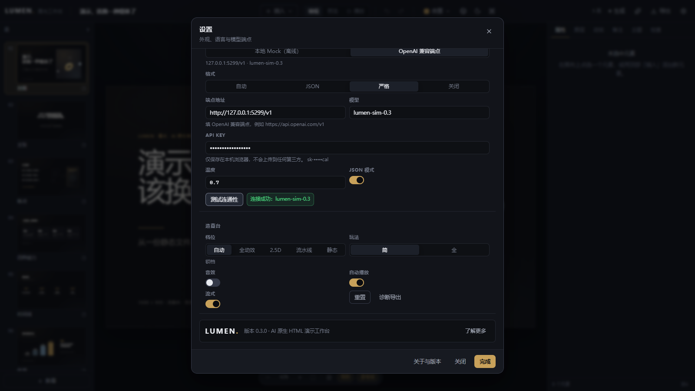

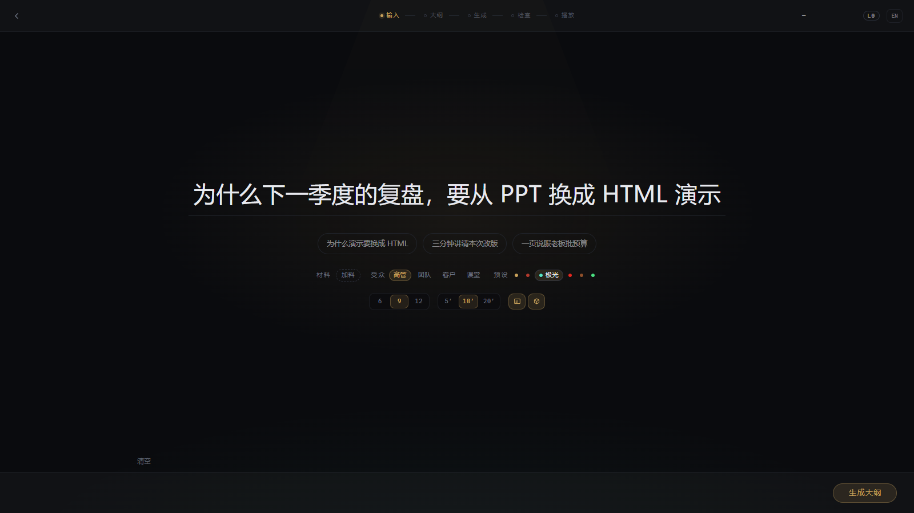

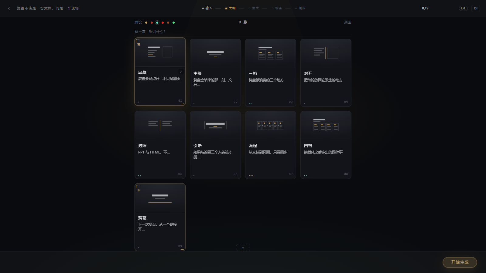

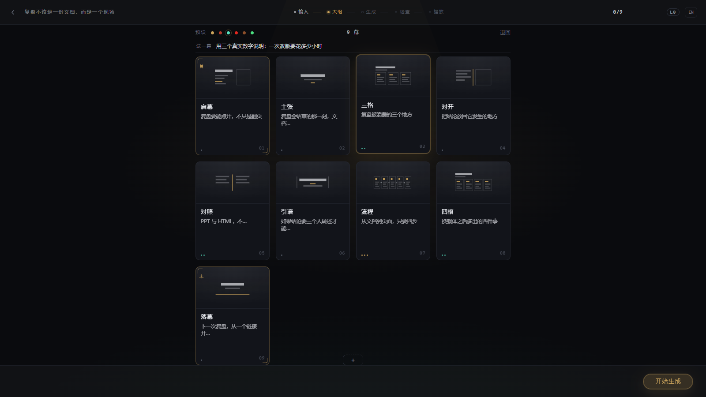

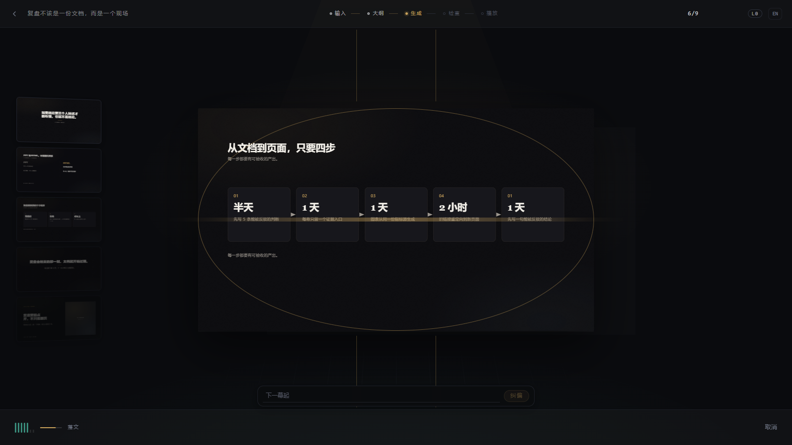

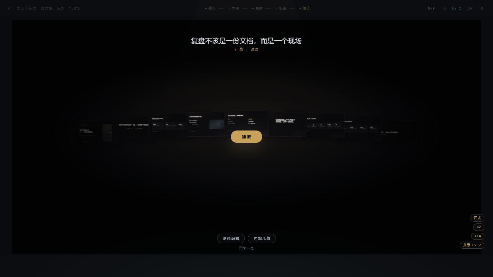

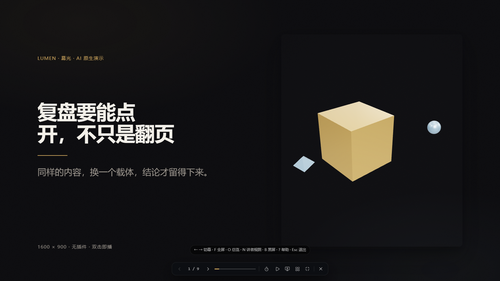

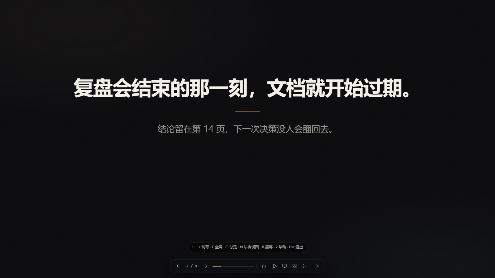

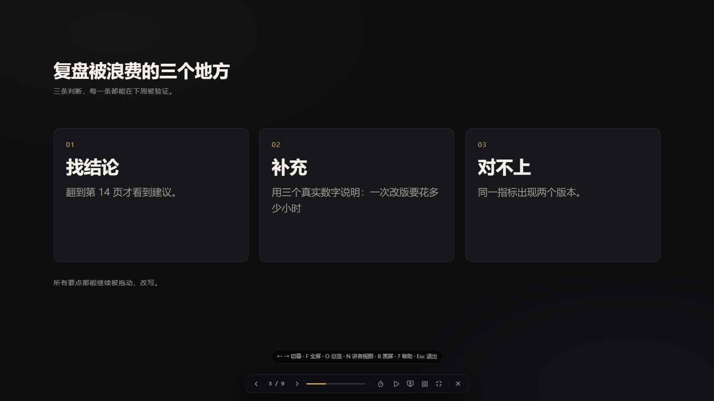

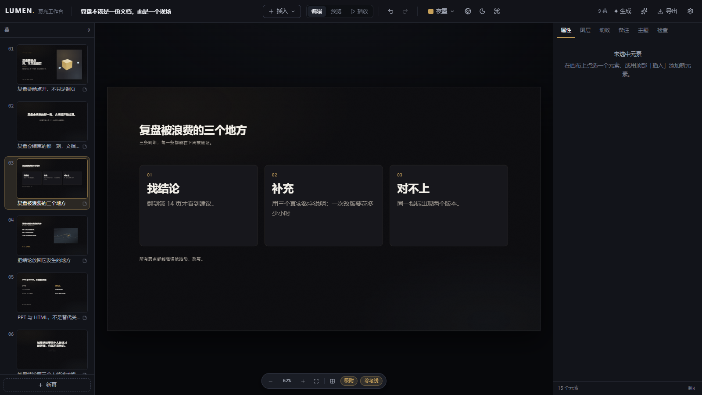

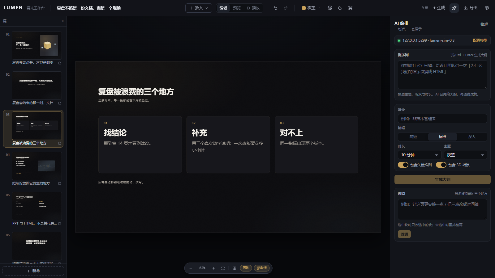

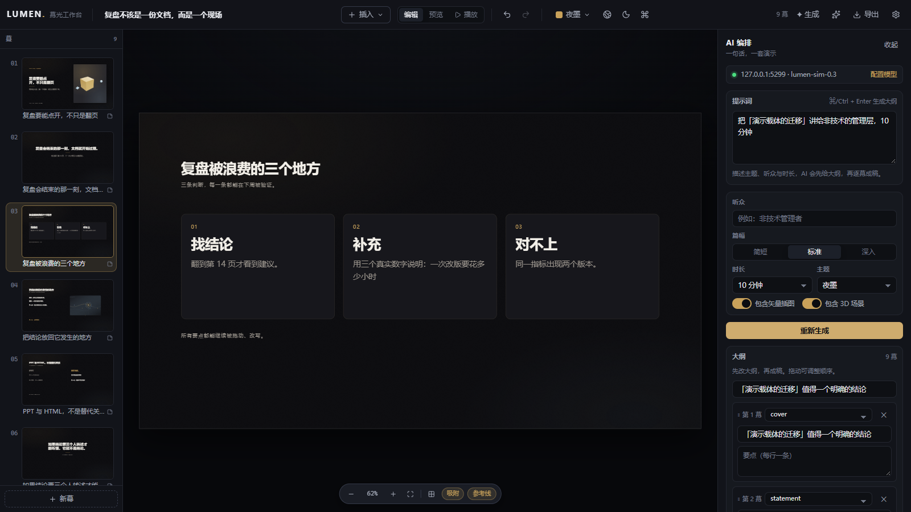

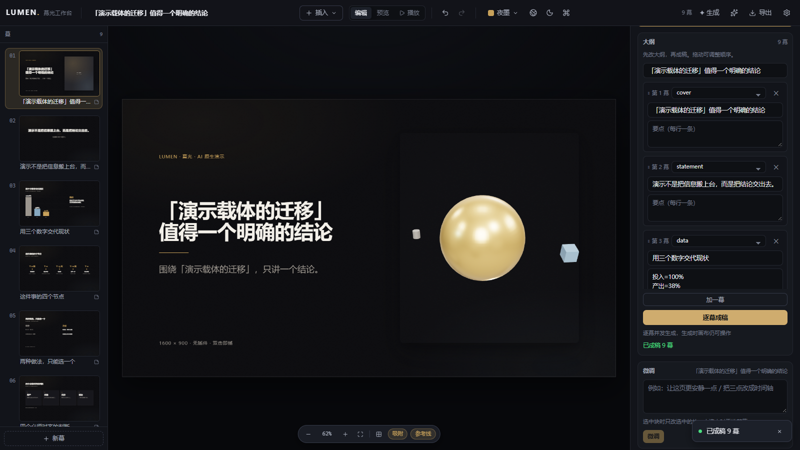

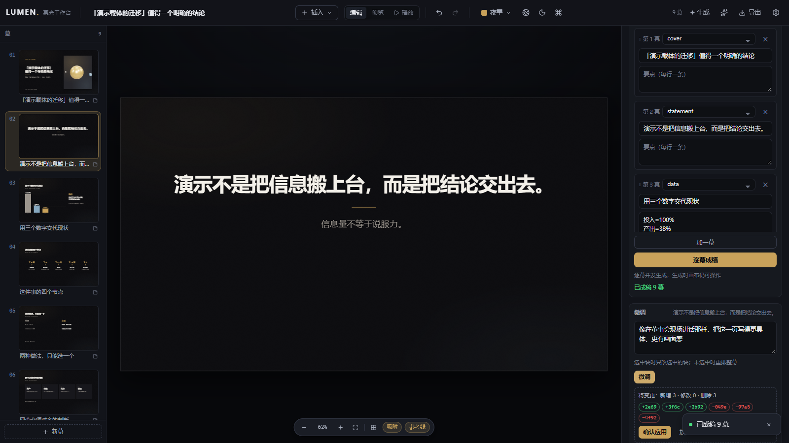

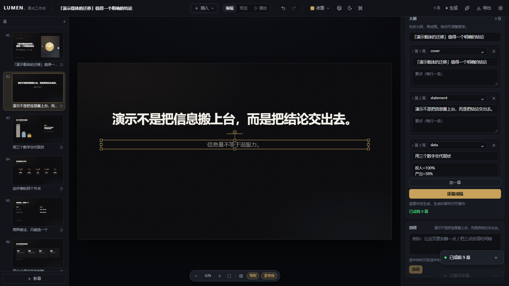

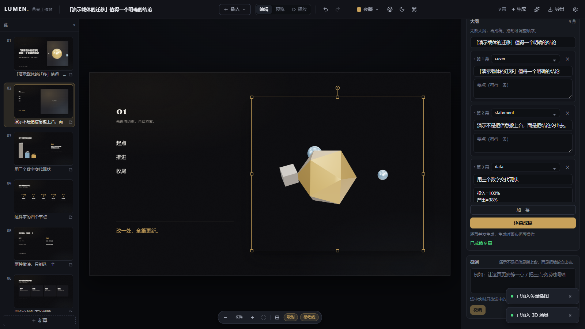

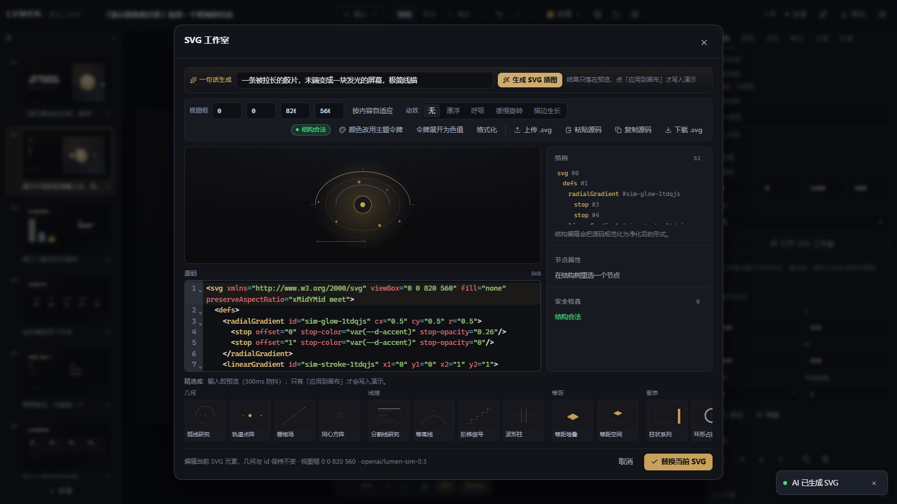

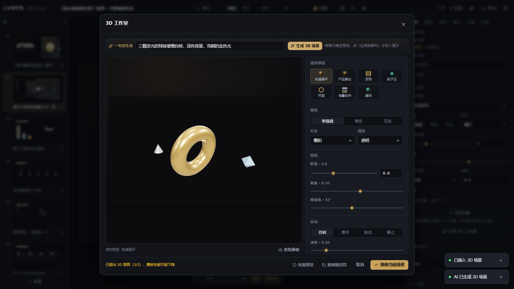

